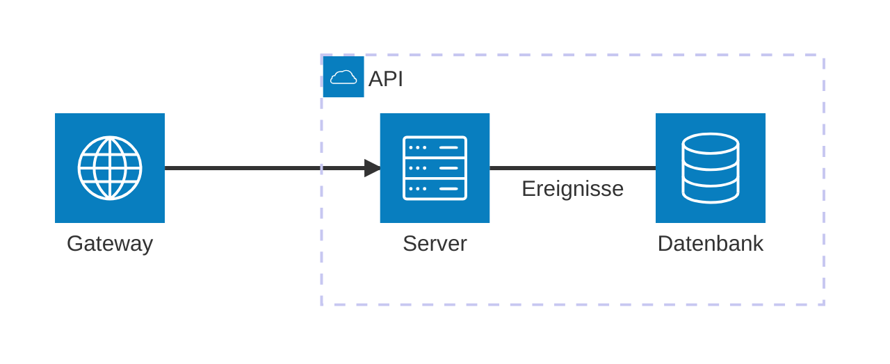

# Architekturdiagramm

Dienste mit Symbolen, gruppiert, mit Verbindungen dazwischen — angeordnet
wie ein [Flussdiagramm](flowchart.md), von links nach rechts.

| Syntax | |
|---|---|
| `service id(symbol)[Titel]`, `… in gruppe` | ein Dienst; Symbole `cloud`, `database`, `disk`, `internet`, `server` (jeder andere Name, etwa `aws:sqs`, zeichnet einen Kasten) |
| `group id(symbol)[Titel]`, `… in gruppe` | eine Gruppe, in einer anderen verschachtelt oder nicht |
| `junction id`, `… in gruppe` | ein Punkt, an dem sich Verbindungen treffen |
| `a:R -- L:b` | eine Verbindung; die Seiten (`L`, `R`, `T`, `B`) werden akzeptiert, das Layout führt sie |
| `-->`, `<--`, `<-->` | Pfeilspitzen |
| `a:R -[Text]- L:b` | eine Beschriftung |
| `a{group}:R -- L:b` | die Verbindung beginnt an der Gruppe, in der `a` ist |
