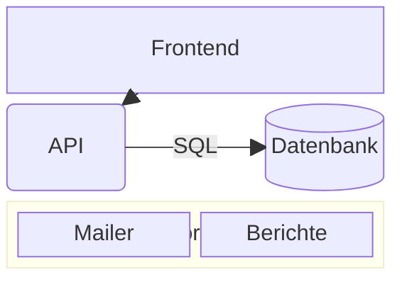

# Blockdiagramm

Blöcke, von Hand auf einem Raster platziert — anders als ein
Flussdiagramm, das sich selbst anordnet.

| Syntax | |
|---|---|
| `columns 3` | die Spaltenzahl; ohne sie alles in einer Zeile |
| `a b c` | Blöcke, füllen die Zeilen von links nach rechts |
| `id:2` | ein Block zwei Spalten breit |
| `space`, `space:2` | leere Zellen |
| `a["Text"]`, `a("…")`, `a(("…"))`, `a[("…")]`, `a{"…"}`, `a{{"…"}}`, `a>"…"]`, `a[/"…"/]` … | die Formen des [Flussdiagramms](flowchart.md) |
| `block:id["Titel"]:3` … `end` | ein verschachteltes Raster mit eigenen `columns` |
| `a --> b`, `a --- b`, `a -.-> b`, `a ==> b`, `a -- "Text" --> b` | Verbindungen, gerade zwischen Blöcken oder Gruppen |
| `style a fill:…`, `classDef`, `class a name`, `a:::name` | Stile |
