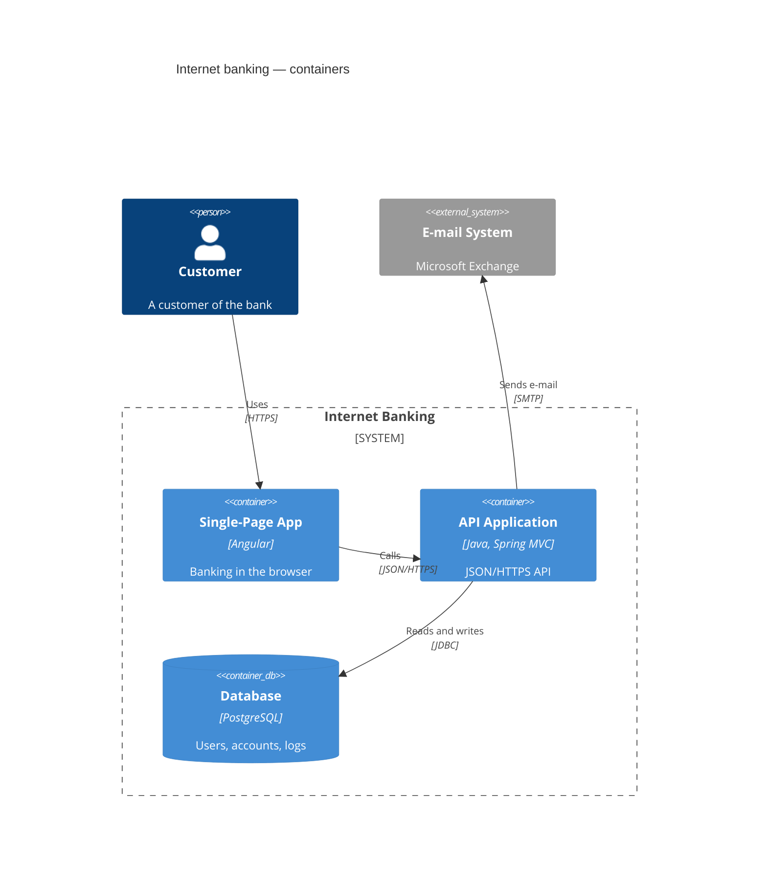

# C4-Diagramme



Das [C4-Modell](https://c4model.com) in der Syntax von Mermaid, die der
Syntax von C4-PlantUML folgt: jede Anweisung ist ein Makroaufruf. Die
Diagramme haben das klassische C4-Aussehen — Personen, blaue Kästen, die
von Systemen zu Komponenten heller werden, graue externe Elemente,
gestrichelte Grenzen.

## Kopfzeile

Eines von `C4Context`, `C4Container`, `C4Component`, `C4Dynamic`,
`C4Deployment`. Alle teilen dieselbe Syntax; das Schlüsselwort ändert nur,
was nummeriert wird (siehe [C4Dynamic](#c4dynamic)). `title …` in einer
eigenen Zeile setzt einen Titel über das Diagramm und ist sein
zugänglicher Name; `accTitle:` und `accDescr:` funktionieren wie überall.
Kommentare beginnen mit `%%`.

## Argumente

Argumente sind positionell oder benannt und lassen sich mischen:

```
Container(api, "API", "Go", "Serves the shop")
Container(api, "API", $techn="Go", $descr="Serves the shop")
```

Werte stehen in Anführungszeichen (`"…"`, nötig für Kommas und Klammern)
oder ohne. `<br>` und das `\n` von C4-PlantUML brechen die Zeile um;
längerer Text wird von selbst umbrochen. `$sprite`, `$tags`, `$link` und
`$baseShape` werden angenommen und ignoriert — Symbole, Tags und Links
werden nicht gezeichnet. Ein benanntes Argument, das das Makro nicht kennt,
ist ein Fehler: ein Tippfehler wird gemeldet statt still verworfen.

## Elemente

| Makro | Parameter |
|---|---|
| `Person`, `Person_Ext` | alias, label, ?descr, ?sprite, ?tags, ?link |
| `System`, `SystemDb`, `SystemQueue` (+ `_Ext`) | alias, label, ?descr, ?sprite, ?tags, ?link |
| `Container`, `ContainerDb`, `ContainerQueue` (+ `_Ext`) | alias, label, ?techn, ?descr, ?sprite, ?tags, ?link |
| `Component`, `ComponentDb`, `ComponentQueue` (+ `_Ext`) | alias, label, ?techn, ?descr, ?sprite, ?tags, ?link |

Jedes Element zeigt seinen Namen fett, eine Typzeile — `[Person]`,
`[Software System]`, `[Container: Technologie]`,
`[Component: Technologie]`, bei `_Ext` mit vorangestelltem `External` —
und seine Beschreibung. `$type="…"` bei einer Person oder einem System
ersetzt die Typzeile. `…Db`-Elemente sind Zylinder, `…Queue`-Elemente
liegende Röhren. Aliase müssen eindeutig sein.

## Grenzen

```
Enterprise_Boundary(corp, "Big Bank plc") {
    System_Boundary(bank, "Internet Banking") {
        Container(api, "API", "Java")
    }
    Boundary(team, "Payments team", "squad") {
        Component(pay, "Payments", "Spring Bean")
    }
}
```

| Makro | Parameter | Typzeile |
|---|---|---|
| `Boundary` | alias, label, ?type, ?tags, ?link | `[type]`, wenn angegeben |
| `Enterprise_Boundary` | alias, label, ?tags, ?link | `[Enterprise]` |
| `System_Boundary` | alias, label, ?tags, ?link | `[Software System]` |
| `Container_Boundary` | alias, label, ?tags, ?link | `[Container]` |

Grenzen lassen sich beliebig tief verschachteln. Der Rumpf ist `{ … }`; die
öffnende Klammer darf in der nächsten Zeile stehen, `{}` ist eine leere
Grenze. Grenzen sind gestrichelte Rahmen mit Name und Typ oben links. Eine
Beziehung darf auf eine Grenze zeigen: sie endet an deren Rahmen.

## Deployment-Knoten

```
Deployment_Node(dc, "Big Bank plc", "Data centre") {
    Node(api, "bigbank-api x8", "Ubuntu 22.04") {
        Container(app, "API Application", "Java and Spring MVC")
    }
}
```

`Deployment_Node`, `Node`, `Node_L`, `Node_R` (und `Deployment_Node_L`,
`Deployment_Node_R`): alias, label, ?type, ?descr, ?sprite, ?tags, ?link.
Sie verschachteln sich wie Grenzen und werden als durchgezogene Rahmen
gezeichnet, mit jeder Ebene etwas dunkler. `_L` und `_R` sind in PlantUML
Ausrichtungshinweise und werden hier wie `Node` gezeichnet.

## Beziehungen

| Makro | Pfeil | Layout-Hinweis |
|---|---|---|
| `Rel(from, to, label, ?techn, ?descr)` | bei `to` | — |
| `BiRel(…)` | an beiden Enden | — |
| `Rel_Back(from, to, …)` | bei `from` | — |
| `Rel_D` / `Rel_Down` | bei `to` | `to` unter `from` |
| `Rel_U` / `Rel_Up` | bei `to` | `to` über `from` |
| `Rel_R` / `Rel_Right` | bei `to` | `to` rechts von `from` |
| `Rel_L` / `Rel_Left` | bei `to` | `to` links von `from` |
| `BiRel_U`, `BiRel_D`, `BiRel_L`, `BiRel_R` (und Langformen) | an beiden Enden | wie oben |
| `RelIndex(index, from, to, label, …)` | bei `to` | — |
| `Lay_U`, `Lay_D`, `Lay_L`, `Lay_R` (und Langformen) | nicht gezeichnet | wie oben |

Beziehungen sind gestrichelte Linien mit der Beschriftung auf der Linie und
der Technologie in eckigen Klammern darunter, `$descr` kursiv darunter.
Sie dürfen vor den Elementen stehen, die sie verbinden. Eine Beziehung
zwischen einem Element und einer Grenze, die es enthält, ist ein Fehler.

**Layout-Hinweise.** Das Diagramm wird in Schichten angeordnet wie bei
C4-PlantUML (Graphviz): Beziehungen verlaufen von oben nach unten, und
jedes Element steht so nah wie möglich an dem, womit es verbunden ist.
`Rel_U` dreht eine Beziehung gegen den Fluss. `Rel_L` und `Rel_R` stellen
die beiden Elemente nebeneinander in eine Reihe, die Beziehung gerade
dazwischen; können sie keine Reihe teilen (verschiedene Grenzen, oder die
Reihe müsste aufgebrochen werden), wird die Beziehung gerade gezeichnet,
wenn nichts im Weg ist, und sonst wie eine gewöhnliche angeordnet. `Lay_*`
gibt dieselben Hinweise, ohne etwas zu zeichnen.

`LAYOUT_LEFT_RIGHT()` (oder `LAYOUT_LANDSCAPE()`) lässt Beziehungen von
links nach rechts laufen; die Hinweise behalten ihre Bedeutung auf der
Seite — `Rel_D` setzt das Ziel weiterhin darunter. `LAYOUT_TOP_DOWN()` ist
der Standard.

## C4Dynamic

In einem `C4Dynamic`-Diagramm wird jede Beziehung in der Reihenfolge ihres
Auftretens nummeriert; die Nummer steht in einem Kreis vor der
Beschriftung. `RelIndex` setzt die Nummer selbst — `RelIndex(5, a, b, "…")`
zeigt 5 und fährt mit 6 fort; ein nicht numerischer Index wie `"2a"` wird
so gezeigt, wie er geschrieben ist. `Index()` nimmt die nächste Nummer,
`LastIndex()` wiederholt die letzte. In den anderen C4-Diagrammen zeigt nur
`RelIndex` eine Nummer.

## Stile und Layout

```
UpdateElementStyle(customer, $bgColor="grey", $fontColor="white", $borderColor="black")
UpdateBoundaryStyle(bank, $borderColor="#b91c1c")
UpdateRelStyle(customer, spa, $textColor="blue", $lineColor="blue")
UpdateLayoutConfig($c4ShapeInRow="3", $c4BoundaryInRow="1")
```

- `UpdateElementStyle` / `UpdateBoundaryStyle`: `$bgColor`, `$fontColor`,
  `$borderColor`. Farben werden geprüft (`#rgb`, `#rrggbb`, `rgb(…)`,
  `hsl(…)`, Namen); alles andere ist ein Fehler. `$shadowing`, `$shape`,
  `$sprite`, `$techn`, `$legendText`, `$legendSprite`, `$borderStyle` und
  `$borderThickness` werden angenommen und ignoriert.
- `UpdateRelStyle(from, to, …)`: `$textColor` und `$lineColor` für jede
  Beziehung von `from` nach `to`. `$offsetX` und `$offsetY` werden
  angenommen und ignoriert: Beschriftungen bekommen im Layout eigenen
  Platz, und für Mermaids Platzierung geschriebene Versätze würden sie nur
  von ihrer Linie schieben.
- `UpdateLayoutConfig`: Elemente und Grenzen, die keine Beziehung berührt,
  werden in Reihen umbrochen — `$c4ShapeInRow` Elemente (Standard 4) und
  `$c4BoundaryInRow` Grenzen (Standard 2) pro Reihe, in
  Schreibreihenfolge, wie in Mermaid. Verbundene Elemente werden nach
  ihren Beziehungen angeordnet.

## Theming

Die Palette ist die des C4-Modells: `--dg-c4-person-*`,
`--dg-c4-system-*`, `--dg-c4-container-*`, `--dg-c4-component-*` und
`--dg-c4-external-*` (`-fill`, `-stroke`, `-text`), dazu
`--dg-c4-boundary-*` und `--dg-c4-node-*` für Rahmen; siehe
[Theming](theming.md#variablen). Die Elementfarben sind auf hellen und
dunklen Seiten gut lesbar; Grenzen, Deployment-Knoten und
Beziehungsbeschriftungen folgen `--dg-text`, `--dg-text-muted`,
`--dg-line` und `--dg-edge-label-fill`, sodass ein dunkles Theme für die
anderen Diagramme auch C4 abdeckt.

Elemente tragen `dg-c4-element`, `dg-c4-<Ebene>` (`person`, `system`,
`container`, `component`), `dg-c4-<Form>` (`box`, `person`, `db`,
`queue`) und `dg-c4-external` sowie `data-id` mit dem Alias.

## Nicht unterstützt

Das sind Fehler, keine still übergangenen Anweisungen:

- Legenden: `SHOW_LEGEND()`, `LAYOUT_WITH_LEGEND()`, `SHOW_FLOATING_LEGEND()`.
- Tags und ihre Stile: `AddElementTag`, `AddRelTag`, `AddBoundaryTag`,
  `UpdateElementTag` und ähnliche (`$tags`-Argumente werden dagegen
  ignoriert).
- Eigenschaften: `SetPropertyHeader`, `AddProperty`,
  `WithoutPropertyHeader`.
- `Rel_Neighbor`, `Lay_Distance`, `LAYOUT_AS_SKETCH()`, `HIDE_STEREOTYPE()`
  und die Schalter für Personen-Sprites.
- Präprozessorzeilen von PlantUML (`!include`, `!define`).

Sprites und Links werden ignoriert: `$sprite`- und `$link`-Argumente werden
angenommen, aber nichts wird für sie gezeichnet.
