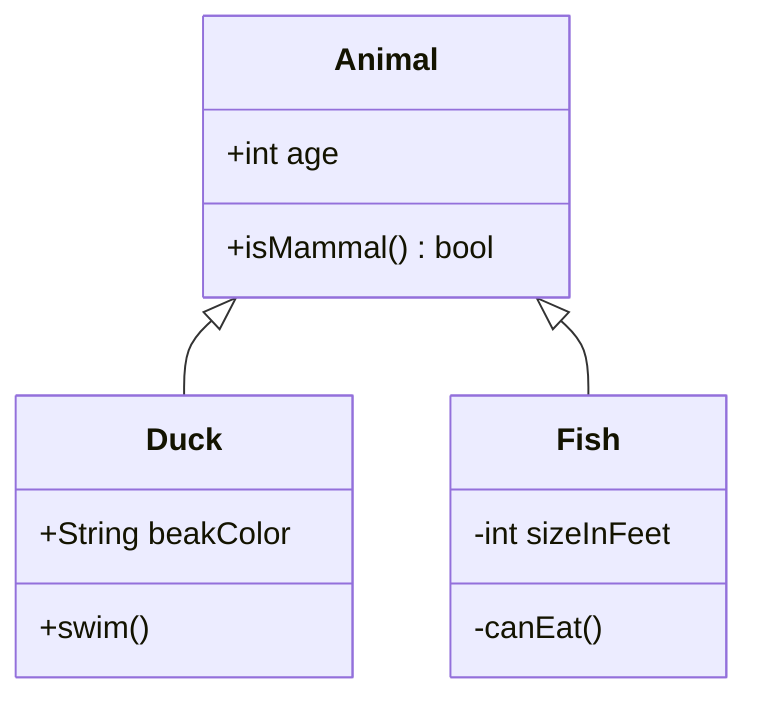

# Klassendiagramm



## Kopfzeile

`classDiagram` (oder `classDiagram-v2`). `direction TB|BT|LR|RL` in einer
eigenen Zeile legt die Richtung fest (standardmäßig von oben nach unten).

## Klassen

| Syntax | Bedeutung |
|---|---|
| `class Animal` | eine Klasse |
| `class Square~T~` | eine generische Klasse, angezeigt als `Square<T>` |
| `class Animal["Animal with a label"]` | eine Klasse mit Anzeigenamen |
| `class Shape <<interface>>` | eine Klasse mit Annotation |
| `class Animal:::name` | die Klasse erhält die Stilklasse `name` |
| `class Duck {` … `}` | eine Klasse mit einem Rumpf aus Elementen |

IDs bestehen aus Buchstaben (jeder Schrift), Ziffern und `_`, mit `-`
dazwischen. Eine Klasse entsteht auch durch die erste Beziehung, die sie
erwähnt.

## Elemente

Im Klassenrumpf ein Element pro Zeile; außerhalb davon `Class : member`:

```
class BankAccount {
    +String owner
    +BigDecimal balance$
    +deposit(amount) bool
    +withdraw(amount)* int
}
BankAccount : -List~Transaction~ history
```

Ein Element mit Klammern ist eine Methode, alles andere ein Attribut.

- **Sichtbarkeit**: ein erstes Zeichen `+` (public), `-` (private),
  `#` (protected) oder `~` (package) bleibt vor dem Element stehen.
- **Rückgabetyp**: der Text nach `)` — `+isMammal() bool` wird als
  `+isMammal() : bool` angezeigt.
- **Klassifizierer**: `$` am Ende (oder direkt nach `)`) markiert ein
  statisches Element, unterstrichen gezeichnet; `*` ein abstraktes, kursiv
  gezeichnet.
- **Generics**: `List~int~` wird als `List<int>` angezeigt, verschachtelte
  ebenso: `Map~String, List~int~~` → `Map<String, List<int>>`.

Attribute kommen ins erste Fach, Methoden ins zweite. Eine Klasse ganz ohne
Elemente wird nur als ihr Name gezeichnet.

## Annotationen

```
class Shape {
    <<interface>>
}
<<enumeration>> Color
class Service <<service>>
```

Jedes Wort zwischen `<<` und `>>` — `interface`, `abstract`, `enumeration`,
`service` und so weiter — erscheint über dem Klassennamen als `«interface»`.

## Beziehungen

`A <|-- B`, `A --> B : label`, `A "1" *-- "many" B : owns`.

| Syntax | Beziehung | Gezeichnet als |
|---|---|---|
| `<\|--` | Vererbung | hohles Dreieck |
| `*--` | Komposition | gefüllte Raute |
| `o--` | Aggregation | hohle Raute |
| `<--` | Assoziation | offener Pfeil |
| `--` | Verbindung | durchgezogene Linie |
| `<\|..` | Realisierung | hohles Dreieck, gestrichelt |
| `<..` | Abhängigkeit | offener Pfeil, gestrichelt |
| `..` | gestrichelte Verbindung | gestrichelte Linie |

Die Spitze kann an jedem Ende stehen oder an beiden: `B --|> A`, `A *--o B`,
`A <|--|> B`. Eine Beschriftung folgt nach `:`; eine Kardinalität ist ein
String in Anführungszeichen neben ihrer Klasse: `Customer "1" --> "*" Ticket`.
Eine Klasse darf mit sich selbst in Beziehung stehen; die Beziehung wird als
Schleife neben ihr gezeichnet.

Das Layout stellt das „ganze“ Ende einer Beziehung zuerst — die Basisklasse
einer Vererbung, den Container einer Komposition oder Aggregation —, sodass
sich eine Hierarchie von oben nach unten liest, egal in welche Richtung ihre
Pfeile geschrieben sind.

## Namensräume

```
namespace Shapes.Base {
    class Triangle
    class Rectangle {
        double width
    }
}
```

Ein Namensraum fasst Klassendeklarationen in einem Rahmen mit Titel
zusammen. Wie in Mermaid stehen darin nur `class`-Deklarationen und
Annotationen; Beziehungen, Notizen und `Class : member`-Zeilen folgen nach
dem Block. Namensräume lassen sich nicht verschachteln — ein Name mit Punkten
(`A.B`) zeigt eine Hierarchie.

## Notizen

```
note for Duck "can fly\nand swim"
note "a note on its own"
```

`\n` bricht eine Zeile um. Eine Notiz für eine Klasse ist mit ihr durch eine
gestrichelte Linie verbunden; eine Notiz ohne `for` steht für sich.

## Stile und Links

- `classDef name fill:…,stroke:…`, `cssClass "A,B" name`, `class A:::name`
  und `style A …` funktionieren wie in
  [Flussdiagrammen](flowchart.md#stile-und-klassen), mit denselben geprüften
  Eigenschaften. Die Füllung färbt das Kopfband; die Elementfächer behalten
  ihren eigenen Hintergrund.
- `link A "url" "tooltip"` und `click A href "url" "tooltip" _blank` machen
  eine Klasse zum Link — mit demselben Schema-Filter wie in Flussdiagrammen.
- `callback A "fn"` und `click A call fn()` werden akzeptiert und ignoriert:
  Skripte aus dem Diagrammtext werden nie ausgeführt.

## Kommentare

`%%` beginnt einen Kommentar, in einer eigenen Zeile oder nach einer
Anweisung.

## Nicht unterstützt

- Lollipop-Schnittstellen (`()--`, `--()`).
- Klassennamen in Backticks (`` class `Animal Class!` ``) — verwenden Sie
  eine Beschriftung: `class Animal["Animal Class!"]`.
- Generische Parameter in Beziehungsanweisungen (`A~T~ <|-- B`) — deklarieren
  Sie das Generic mit `class A~T~` und verweisen Sie auf die Klasse als `A`.
- Verschachtelte Namensräume.
- Front Matter (`---` … `---`) und `title`.
