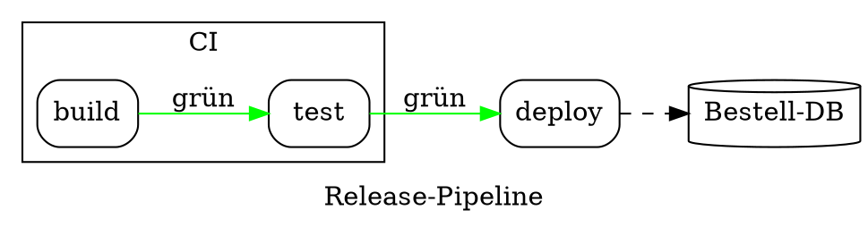

# Graphviz DOT

Eine Quelle, die mit `digraph` oder mit `graph` und einem Rumpf in
geschweiften Klammern beginnt, ist DOT (Mermaids `graph TD` hat keine
Klammern). Ausdrücklich: `render(source, { syntax: 'dot' })`. DOT wird mit
dem Layout des Flussdiagramms gezeichnet, nicht mit Graphviz — derselbe
Graph sieht hier wie ein Flussdiagramm aus.

| Syntax | |
|---|---|
| `graph` / `digraph`, `strict` | ungerichtet (`--`) oder gerichtet (`->`) |
| `a`, `a [label="…", shape=box]` | ein Knoten und seine Attribute |
| `a -> b -> c [label="…"]`, `a -> {b c}` | Kantenketten, zu mehreren Knoten zugleich |
| `node [ … ]`, `edge [ … ]`, `graph [ … ]` | Vorgaben für das Folgende, je Subgraph |
| `rankdir=LR`, `label="…"` | Richtung (`TB`, `LR`, `BT`, `RL`) und ein Titel |
| `subgraph cluster_x { label="…"; … }` | ein gerahmter Cluster; ein Subgraph ohne `cluster` gruppiert nur |
| `a:port` | Ports werden akzeptiert |
| `;`, Zeilenumbrüche, `//`, `/* */`, `#` | Trenner und Kommentare |

**Attribute.** Knoten: `label` (Records `{a|b}` werden zu Zeilen; HTML-Labels
`<…>` verlieren ihre Tags; `\n`, `\l`, `\r` brechen um), `shape` (box, rect,
ellipse, oval, circle, point, doublecircle, diamond, hexagon,
parallelogram, trapezium, invtrapezium, cylinder, note, folder, tab,
component, box3d, plaintext, record, Mrecord, …), `style` (rounded,
filled, dashed, dotted, invis), `color`, `fillcolor`, `fontcolor`. Kanten:
`label`, `style` (dashed, dotted, bold, invis), `color`, `penwidth`, `dir`
(forward, back, both, none), `arrowhead` und `arrowtail` (normal, vee,
empty, diamond, odiamond, dot, none, tee, …), `minlen`. Cluster: `label`,
`bgcolor`, `color`. Farben sind Namen oder `#rrggbb`; andere werden
ignoriert. Layout-Attribute von Graphviz (`pos`, `rank`, `constraint`,
`splines`…) werden akzeptiert und tun nichts.
