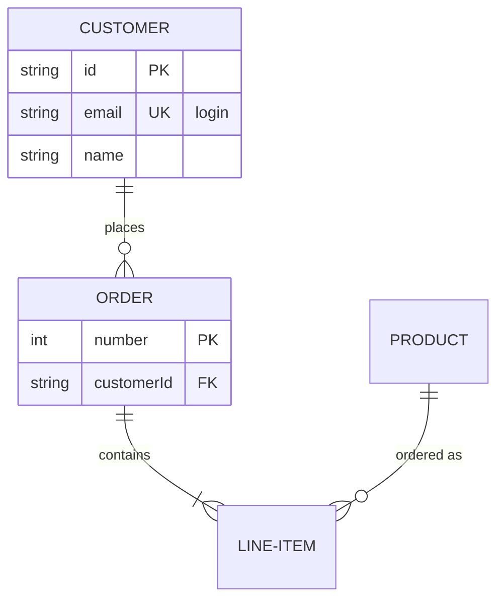

# ER-Diagramm



## Kopfzeile

`erDiagram`. `direction TB|BT|LR|RL` in einer eigenen Zeile legt die
Richtung fest (standardmäßig von oben nach unten).

## Entitäten

| Syntax | Bedeutung |
|---|---|
| `CUSTOMER` | eine Entität, benannt nach ihrer ID |
| `LINE-ITEM` | IDs bestehen aus Buchstaben (jeder Schrift), Ziffern und `_`, mit `-` dazwischen |
| `"Order line"` | ein beliebiger Name in doppelten Anführungszeichen, auch mit Leerzeichen |
| `p["Person"]` oder `p[Person]` | ein Alias: der Kasten zeigt „Person“, Beziehungen verwenden `p` |
| `CUSTOMER:::name` | die Entität erhält die Klasse `name` (siehe [Stile](#stile)) |

Eine Entität entsteht mit der ersten Anweisung, die sie erwähnt; eine
Beziehung genügt dafür.

## Attribute

```
CUSTOMER {
    string id PK "the key"
    string email UK
    int orderNumber PK, FK
    decimal(10,2) total
    string[] tags
}
```

Ein Attribut pro Zeile innerhalb von `{` … `}`: ein Typ, ein Name, danach
optional Schlüssel und ein Kommentar.

- **Typ**: beginnt mit einem Buchstaben, `_` oder `*`; darf `[]`, `()`, `,`
  und `-` enthalten — `decimal(10,2)`, `string[]`.
- **Name**: ein Wort; darf mit `*` beginnen.
- **Schlüssel**: `PK`, `FK`, `UK`, mehrere durch Kommas getrennt.
- **Kommentar**: Text in doppelten Anführungszeichen.

Die Entität wird als Tabelle gezeichnet: ihr Name in einem Kopfband, darunter
eine Zeile pro Attribut, mit Typ, Name, Schlüsseln und Kommentar in
ausgerichteten Spalten. Eine Entität ohne Attribute ist nur ihr Name.
`CUSTOMER {}` deklariert eine leere Entität.

## Beziehungen

```
CUSTOMER ||--o{ ORDER : places
CUSTOMER }|..|{ ADDRESS : "ships to"
```

Eine Beziehung besteht aus der ersten Entität, einer Kardinalität, einer
Linie, einer Kardinalität, der zweiten Entität und optional `:` mit einer
Beschriftung (mit oder ohne Anführungszeichen).

| Links | Rechts | Kardinalität |
|---|---|---|
| `\|\|` | `\|\|` | genau eins |
| `\|o` | `o\|` | null oder eins |
| `}\|` | `\|{` | eins oder mehr |
| `}o` | `o{` | null oder mehr |

| Linie | Bedeutung |
|---|---|
| `--` | identifizierend: durchgezogene Linie |
| `..` (auch `.-`, `-.`) | nicht identifizierend: gestrichelte Linie |

Jedes Ende wird in Krähenfuß-Notation gezeichnet, dort wo die Linie auf die
Entität trifft. Eine Entität darf mit sich selbst in Beziehung stehen; die
Beziehung wird als Schleife neben ihr gezeichnet.

**Wortformen.** Auch Mermaids ausgeschriebene Kardinalitäten funktionieren,
mit `to` (identifizierend) oder `optionally to` (nicht identifizierend)
anstelle der Linie:

```
CAR 1 to zero or more NAMED-DRIVER : allows
PERSON only one optionally to one or many ADDRESS : has
```

| Wörter | Kardinalität |
|---|---|
| `only one`, `1` | genau eins |
| `zero or one`, `one or zero` | null oder eins |
| `one or more`, `one or many`, `many(1)`, `1+` | eins oder mehr |
| `zero or more`, `zero or many`, `many(0)`, `0+` | null oder mehr |

## Stile

`classDef name fill:…,stroke:…`, `class a,b name`, `ENTITY:::name` und
`style id …` funktionieren wie in [Flussdiagrammen](flowchart.md#stile-und-klassen),
mit denselben geprüften Eigenschaften. Bei einer Entität mit Attributen
färbt die Füllung das Kopfband; die Zeilen behalten ihren eigenen
Hintergrund, damit ihr Text auch im dunklen Theme lesbar bleibt.

## Kommentare

`%%` beginnt einen Kommentar, in einer eigenen Zeile oder nach einer
Anweisung.

## Nicht unterstützt

- Attribute in der Zeile der öffnenden `{` oder mehrere Attribute in einer
  Zeile.
- Eine Klasse (`:::`) an einer Entität innerhalb einer Beziehungsanweisung —
  setzen Sie sie an eine Deklaration.
- Front Matter (`---` … `---`) und `title`.
