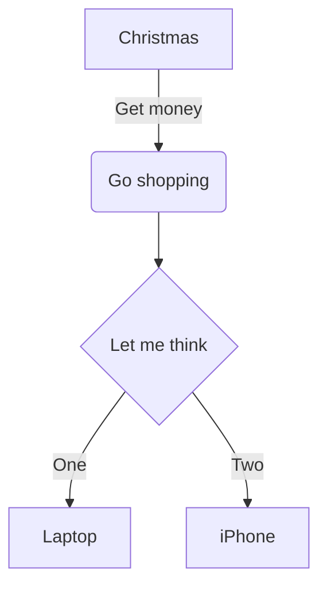
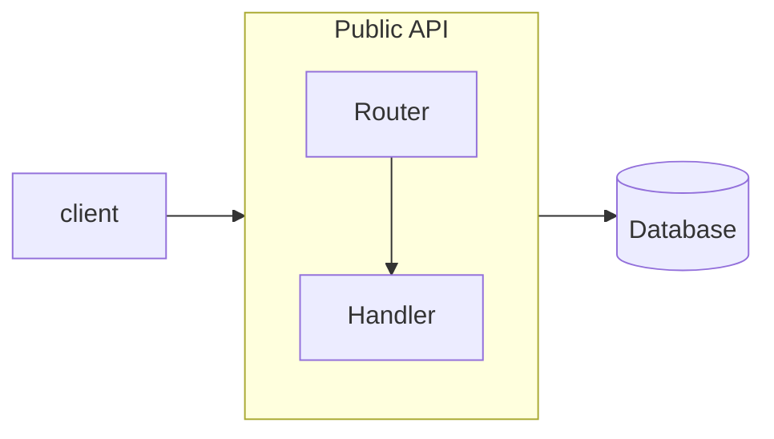

# Flussdiagramm



## Kopfzeile und Richtung

`flowchart` oder `graph`, gefolgt von einer Richtung: `TB` (oder `TD`, von
oben nach unten — der Standard), `BT`, `LR`, `RL`.

## Knoten

Ein Knoten ist eine ID, optional gefolgt von seinem Text in einer Form:

| Syntax | Form |
|---|---|
| `id` | Rechteck mit der ID als Text |
| `id[text]` | Rechteck |
| `id(text)` | abgerundetes Rechteck |
| `id([text])` | Stadion |
| `id[[text]]` | Unterprogramm |
| `id[(text)]` | Zylinder (Datenbank) |
| `id((text))` | Kreis |
| `id(((text)))` | Doppelkreis |
| `id>text]` | asymmetrisch |
| `id{text}` | Raute (Entscheidung) |
| `id{{text}}` | Sechseck |
| `id[/text/]` | Parallelogramm |
| `id[\text\]` | Parallelogramm, andersherum |
| `id[/text\]` | Trapez |
| `id[\text/]` | Trapez, andersherum |

IDs bestehen aus Buchstaben (beliebiger Schrift), Ziffern, `_`, `.`, `$`
und `-` zwischen Buchstaben.

**Text.** Setzen Sie Text in doppelte Anführungszeichen, um Klammern oder
andere Sonderzeichen darin zu verwenden: `A["a (b) [c]"]`. `<br>` bricht die
Zeile um — es ist das einzige verstandene HTML; jedes andere Markup wird als
Text angezeigt. Mermaids Entity-Codes funktionieren: `#quot;`, `#35;`,
`#x23;`.

**Markdown-Strings.** Text in Backticks innerhalb von Anführungszeichen,
``A["`**bold** and *italic*`"]``, unterstützt `**bold**` und `*italic*` /
`_italic_`, echte Zeilenumbrüche und wird bei 200 Pixeln umbrochen.

## Kanten

| Syntax | Kante |
|---|---|
| `A --> B` | Pfeil |
| `A --- B` | Linie ohne Spitze |
| `A -.-> B` / `A -.- B` | gepunktet |
| `A ==> B` / `A === B` | dick |
| `A --o B` | Kreisspitze |
| `A --x B` | Kreuzspitze |
| `A <--> B`, `A o--o B`, `A x--x B` | Spitzen an beiden Enden |
| `A ~~~ B` | unsichtbar: beeinflusst das Layout, wird nicht gezeichnet |

**Länge.** Zusätzliche Striche lassen eine Kante mehr Ränge überspannen:
`-->` einen, `--->` zwei, `---->` drei; ebenso bei `-..->` und `===>`.

**Text an Kanten.** `A -->|text| B`, `A -- text --> B`, `A -. text .-> B`,
`A == text ==> B`. Anführungszeichen und Markdown-Strings funktionieren wie
bei Knoten.

**Ketten und Gruppen.** `A --> B --> C` sind zwei Kanten. `A & B --> C & D`
sind vier.

## Subgraphen



- `subgraph id`, `subgraph id [title]`, `subgraph "title"` oder
  `subgraph title with spaces` (die ID ist dann der Titel mit `_` statt
  Leerzeichen); abgeschlossen mit `end`. Subgraphen lassen sich verschachteln.
- Ein Knoten gehört zum ersten Subgraphen, in dem er erwähnt wird. Eine
  erneute Erwähnung auf oberster Ebene holt ihn nicht heraus.
- Kanten können über die ID auf einen Subgraphen zeigen; sie enden an seinem
  Rahmen.
- `direction` innerhalb eines Subgraphen legt dessen eigene Richtung fest.
  Wie in Mermaid wird sie beachtet, wenn kein Knoten im Subgraphen mit einem
  Knoten außerhalb verbunden ist (Kanten zum Subgraphen selbst sind erlaubt).
  Ein solcher Subgraph wird separat angeordnet und als ein Block platziert;
  ein Subgraph, dessen Rahmen von Kanten gekreuzt wird, wird zusammen mit dem
  Rest des Diagramms angeordnet.

## Stile und Klassen

```
classDef warn fill:#fde68a,stroke:#b45309,color:#78350f
classDef default stroke-width:2px
A:::warn --> B
class B,C warn
style D fill:#bbf7d0,stroke:#15803d
linkStyle 0 stroke:#dc2626,stroke-width:2px
linkStyle default stroke-dasharray:4 2
```

`classDef default` gilt für jeden Knoten. `linkStyle` zählt Kanten ab 0 in
der Reihenfolge, in der sie geschrieben wurden.

Nur diese Eigenschaften werden akzeptiert, mit geprüften Werten — ein Stil
kann nie eine URL laden oder über das Diagramm hinausgreifen:

| Eigenschaft | Werte |
|---|---|
| `fill`, `stroke`, `color` | `#rgb`, `#rgba`, `#rrggbb`, `#rrggbbaa`, `rgb()`, `rgba()`, `hsl()`, `hsla()`, Farbnamen |
| `stroke-width`, `font-size` | eine Zahl, optional mit `px` oder `em` |
| `stroke-dasharray` | Zahlen |
| `opacity`, `fill-opacity`, `stroke-opacity` | 0 bis 1 |
| `font-weight` | `normal`, `bold`, `100`–`900` |
| `font-style` | `normal`, `italic` |

Alles andere ist ein `DiagramError`, der die Eigenschaft nennt.

## Links

```
click A href "https://example.com" "Tooltip" _blank
click B "/docs/page"
```

Der Knoten wird zu einem Link. Erlaubt sind `http:`, `https:`, `mailto:`,
relative Adressen und Anker; alles andere (`javascript:`, `data:`, …) ist ein
Fehler. `_blank` fügt `rel="noopener noreferrer"` hinzu. `click id callback`
— der Aufruf einer JavaScript-Funktion — wird ignoriert: Nichts aus dem
Diagrammtext wird je ausgeführt.

## Kommentare

`%%` beginnt einen Kommentar bis zum Zeilenende. `%%{init: …}%%`-Direktiven
werden übersprungen.

## Nicht unterstützt

- Die Knotensyntax `A@{ shape: …, label: … }` (Mermaid 11) — ein Fehler;
  verwenden Sie die Klammerformen.
- Kanten-IDs (`A e1@--> B`) und Kantenanimation.
- Font-Awesome-Icons (`fa:fa-car` wird als Text angezeigt).
- `click`-Callbacks (ignoriert, siehe oben).
- HTML in Beschriftungen außer `<br>` (wird als Text angezeigt).
