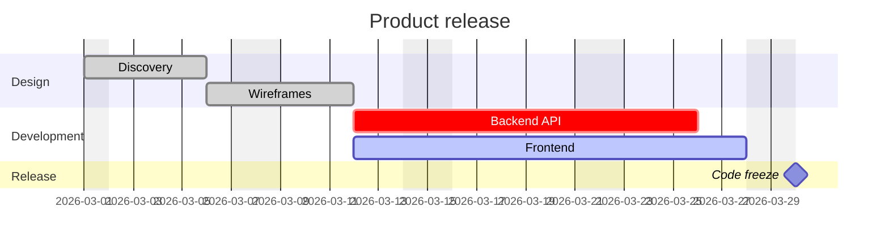

# Gantt-Diagramm



## Einstellungen

Einstellungen gelten für das ganze Diagramm, egal wo sie stehen.

| Einstellung | Bedeutung |
|---|---|
| `title …` | Titel über dem Diagramm |
| `dateFormat …` | wie Daten in Aufgaben geschrieben werden (Standard `YYYY-MM-DD`) |
| `axisFormat …` | wie Daten an der Achse ausgegeben werden (strftime) |
| `tickInterval 1day` | Achsenschritt: eine Zahl und `millisecond`, `second`, `minute`, `hour`, `day`, `week` oder `month` |
| `excludes …` | Tage, die nicht zählen: `weekends`, Wochentagsnamen, Daten — durch Komma oder Leerzeichen getrennt |
| `includes …` | Daten, die zählen, auch wenn sie ausgeschlossen sind |
| `weekend friday` / `weekend saturday` | welche zwei Tage `weekends` bedeutet (Standard Samstag und Sonntag) |
| `inclusiveEndDates` | ein Enddatum schließt diesen Tag ein |
| `todayMarker off` | siehe „Heute“ unten |
| `topAxis` | Achse zusätzlich oben |
| `section …` | beginnt eine Gruppe von Aufgaben |

**`dateFormat`-Tokens:** `YYYY`, `YY`, `MM`, `M`, `DD`, `D`, `HH`, `H`,
`mm`, `m`, `ss`, `s`, `SSS`, `X` (Unix-Sekunden), `x` (Unix-Millisekunden)
und wörtlicher Text in eckigen Klammern (`[brackets]`). Tokens, die Namen
bezeichnen — Monats- und Wochentagsnamen, Ordinalzahlen, AM/PM, Zeitzonen —
sind ein Fehler statt einer Vermutung. Daten werden als UTC gelesen, sodass
das Diagramm nicht von der Zeitzone des Lesers abhängt; ein Datum, das nicht
zum Format passt, ist ein Fehler (Mermaid greift dann auf den Datumsparser
des Browsers zurück, der von ihr abhängt).

**`axisFormat`-Direktiven:** `%Y %y %m %d %e %j %b %B %a %A %u %w %H %I %M
%S %L %p %%`. Ohne `axisFormat` richtet sich das Format nach dem
Achsenschritt: Stunden und Minuten bei Schritten unter einem Tag, Monat und
Jahr bei monatlichen, sonst das Datum.

## Aufgaben

```
Task name : [tags,] [id,] [start,] end-or-duration
```

- **Tags**, in beliebiger Kombination: `done`, `active`, `crit`,
  `milestone`.
- **ID**: ein Wort ohne Leerzeichen, auf das `after` verweisen kann.
- **Start**: ein Datum im `dateFormat` oder `after id1 id2 …` — das späteste
  Ende dieser Aufgaben (sie dürfen weiter unten im Quelltext definiert
  sein). Ohne Start beginnt eine Aufgabe, wenn die vorherige endet; die erste
  Aufgabe braucht einen.
- **Ende**: ein Datum, `until id` (wenn jene Aufgabe beginnt) oder eine
  Dauer: eine Zahl mit `ms`, `s`, `m`, `h`, `d`, `w` (z. B. `3d`, `1.5h`,
  `2w`).

Eine als Dauer angegebene Aufgabe wird über ausgeschlossene Tage gestreckt,
wie in Mermaid; eine Aufgabe mit Enddatum endet dort. Ein Meilenstein wird
als Raute an seinem Start gezeichnet.

Aufgaben ohne ID erhalten `task1`, `task2`, … nach ihrer Position im
Diagramm.

## Links

`click id href "https://…"` macht die Aufgabe zu einem Link (nur `http(s)`,
`mailto`, relativ).

## Heute

Eine Linie für das aktuelle Datum würde die Ausgabe von der Uhr abhängig
machen, daher zeichnet `render` sie nur auf Anfrage, mit dem zu verwendenden
Datum:

```ts
render(source, { today: new Date() })
```

Die Linie erscheint, wenn dieses Datum in den Zeitraum des Diagramms fällt.
`todayMarker off` im Quelltext schaltet sie auch dann ab.

## Nicht unterstützt

- `displayMode compact` — jede Aufgabe erhält eine eigene Zeile.
- `click id call …` — nichts aus dem Diagrammtext wird ausgeführt.
- `vert`-Markierungen.
- `dateFormat`-Tokens, die Namen bezeichnen, strftime `%U %W %Z %q`.
