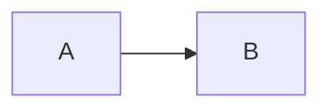

# Erste Schritte

## Installation

```bash
npm install @dskripchenko/diagrams
```

Das Paket ist ein ES-Modul mit einem CommonJS-Build daneben und eigenen
Typdefinitionen. Es hat keine Abhängigkeiten.

## Ein Diagramm rendern

```ts
import { render } from '@dskripchenko/diagrams'

const result = render(`sequenceDiagram
  Alice->>Bob: Hello
  Bob-->>Alice: Hi`)

result.svg     // '<svg xmlns="http://www.w3.org/2000/svg" …>…</svg>'
result.width   // natural size in pixels
result.height
result.type    // 'sequence'
```

Das SVG bringt eigene `width`, `height` und `viewBox` mit sowie den Stil
`max-width:100%;height:auto`; es schrumpft also in einem schmalen Container
und wird nie größer als seine natürliche Größe. Fügen Sie es als Markup in
die Seite ein:

```ts
container.innerHTML = result.svg
```

Der Typ wird aus der ersten Zeile gelesen: `flowchart` oder `graph`,
`sequenceDiagram`, `stateDiagram-v2` (oder `stateDiagram`), `pie`, `gantt`,
`C4Context`, `C4Container`, `C4Component`, `C4Dynamic`, `C4Deployment`.

## Optionen

```ts
render(source, {
  measureText,  // how text is measured — see below
  idPrefix,     // prefix for ids inside the SVG
  title,        // accessible title
  today,        // gantt: draw a "today" line at this date
})
```

**`idPrefix`.** Jede ID im SVG — die Wurzel, die Pfeilspitzen-Marker, das
lokale Stylesheet — beginnt mit diesem Präfix. Standardmäßig ist es ein Hash
des Quelltexts, sodass dasselbe Diagramm immer dieselben IDs erhält. Wird
**dasselbe** Diagramm zweimal auf einer Seite angezeigt, geben Sie jeder
Kopie ein eigenes Präfix.

**`title`.** Das SVG hat `role="img"` und ein `<title>` für Screenreader.
Der Titel stammt aus dieser Option, sonst aus `accTitle:` im Quelltext, sonst
aus dem eigenen Titel des Diagramms, sonst aus seinem Typ. `accDescr:` wird
zu einem `<desc>`.

## Textmessung

Das Layout hängt von der Breite jeder Beschriftung ab, und diese von der
Schrift, die der Browser des Lesers verwendet. Die Messung ist deshalb eine
Funktion, die Sie ersetzen können:

- **Im Browser** misst die Standardfunktion mit einem Canvas
  (`OffscreenCanvas`, wo verfügbar) mit demselben Font-Stack, den das SVG
  anfordert.
- **Ohne DOM** — serverseitiges Rendern, Node-Skripte, Tests — ist
  `approximateMeasurer` der Standard: eine Tabelle mit Glyphenbreiten für
  Latein, Kyrillisch, Ziffern und Satzzeichen, CJK-Zeichen in voller Breite.
  Formen erhalten Innenabstand, damit der kleine Fehler keinen Text
  überlaufen lässt.

```ts
import { render, approximateMeasurer } from '@dskripchenko/diagrams'

// Identical output in every environment: use this for snapshots and caches.
render(source, { measureText: approximateMeasurer })
```

Eine eigene Messfunktion erhält den Text und eine Schrift (`size`, `family`,
`weight`, `style`) und gibt `{ width, height }` in Pixeln zurück.

## Fehler

Ein Quelltext, der nicht gelesen werden kann, löst `DiagramError` aus:

```ts
import { render, DiagramError } from '@dskripchenko/diagrams'

try {
  render(source)
} catch (error) {
  if (error instanceof DiagramError) {
    error.line     // 1-based, 0 when the problem is the diagram as a whole
    error.column   // 1-based, 0 when unknown
    error.hint     // what to write instead, when there is an obvious answer
    error.message  // includes the position
  }
}
```

Unterstützt wird eine festgelegte Teilmenge der Mermaid-Syntax, die in dieser
Dokumentation pro Typ aufgeführt ist. Alles außerhalb davon ist ein Fehler
mit Position — nie ein Bild, in dem stillschweigend etwas fehlt.

## Weitere Funktionen

```ts
import { detect, parse } from '@dskripchenko/diagrams'

detect('pie\n "a" : 1')   // 'pie' — or null when the first line names no known type
parse(source)             // the parsed structure, without layout: for tools and tests
```

## In einem Markdown-Renderer

Die übliche Einbindung ist ein umzäunter Codeblock:

````markdown

````

Übergeben Sie den Text des Blocks an `render` und setzen Sie das SVG an die
Stelle des Codes; bei einem `DiagramError` zeigen Sie stattdessen den Code
und die Meldung. Mit [`@dskripchenko/ui`](https://github.com/dskripchenko/ui)
nimmt `UidMarkdown` genau dafür Block-Renderer entgegen:

```ts
import { render, DiagramError } from '@dskripchenko/diagrams'

const mermaid = (code: string) => {
  try {
    return { html: render(code).svg }
  } catch (error) {
    if (error instanceof DiagramError) return { error: error.message }
    throw error
  }
}
// <UidMarkdown :source="text" :block-renderers="{ mermaid }" />
```

Das SVG kann gefahrlos als Markup eingefügt werden: Jeder Text darin wird vom
Paket maskiert.

## Grenzen

Ein Flussdiagramm oder Zustandsdiagramm darf bis zu 500 Knoten und 2000
Kanten haben; darüber hinaus ist die Laufzeit des Layouts nicht mehr
vorhersehbar, und das Rendern löst `DiagramError` mit dem Vorschlag aus, das
Diagramm aufzuteilen. 500 Knoten werden deutlich unter einer Sekunde
angeordnet.
