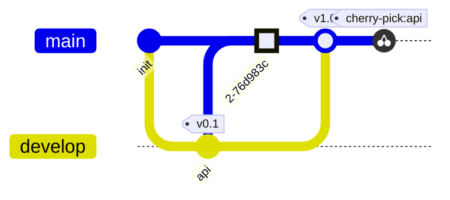

# Git-Graph



Commits in der geschriebenen Reihenfolge, eine Bahn pro Branch; `main`
existiert von Anfang an.

| Syntax | |
|---|---|
| `gitGraph`, `gitGraph TB:`, `gitGraph BT:` | von links nach rechts, von oben nach unten, von unten nach oben |
| `commit` | ein Commit auf dem aktuellen Branch |
| `… id: "x" msg: "…" tag: "v1" type: NORMAL\|REVERSE\|HIGHLIGHT` | seine ID (angezeigt), Nachricht (angezeigt, wenn es keine ID gibt), Tag, Aussehen |
| `branch name`, `… order: 2` | ein neuer Branch vom aktuellen Commit, wird aktuell; `order` setzt seine Bahn |
| `checkout name`, `switch name` | der aktuelle Branch |
| `merge name`, mit den Commit-Optionen | ein Merge-Commit mit zwei Eltern |
| `cherry-pick id: "x"` | eine Kopie von Commit x auf dem aktuellen Branch |

Fehler: ein unbekannter Branch, ein Merge ohne Neues, eine doppelt
verwendete Commit-ID. Bis zu 500 Commits.

## Ein Commit-Graph neben einer Liste

Für eine echte Historie — Commits aus einem Repository, neueste zuerst — ist
der Graph eine eigene Spalte, ausgerichtet an einer Liste, die die Anwendung
selbst zeichnet (Nachrichten, Autoren, Daten): eine Spur je
Entwicklungslinie, eine Zeile je Commit, Kurven bei Abzweigungen und Merges.

```ts
import { renderCommitGraph } from '@dskripchenko/diagrams'

const { svg, width, graph } = renderCommitGraph(
  [
    { id: 'm', parents: ['b', 'f'] }, // ein Merge
    { id: 'f', parents: ['a'] },
    { id: 'b', parents: ['a'] },
    { id: 'a', parents: [] },
  ],
  { rowHeight: 28, head: 'm' },
)
```

Zeile *k* liegt mittig bei `k × rowHeight + rowHeight / 2`, die Spalte passt
also neben Listenzeilen dieser Höhe. Ein Commit nimmt die Spur, die auf ihn
wartet; sein erster Elternteil setzt die Spur fort, weitere Eltern bekommen
eigene; ein Branch läuft neben seiner Basis bis zum gemeinsamen Commit und
biegt dort wieder ein. Merge-Commits sind Ringe, `head` bekommt einen Ring um
seinen Punkt, jede Spur behält eine Farbe der Palette (`--dg-pie-1` …
`--dg-pie-12`). Ein Elternteil, der nicht in der Liste steht (eine gekürzte
Historie), lässt seine Linie bis nach unten laufen.

| Option | Standard | |
|---|---|---|
| `rowHeight` | 28 | die Höhe einer Listenzeile |
| `laneWidth` | 14 | der Abstand zwischen Spuren |
| `radius` | 4 | der Punkt eines Commits |
| `head` | — | der ausgecheckte Commit, markiert |
| `id` | `dg-commits` | die id des `<svg>`, begrenzt seine Styles |
| `title` | Commit graph | für Hilfstechnologien |

Das Ergebnis hat `width` und `height`, `graph` — das Layout (Zeilen mit Spur
und Farbe, die Liniensegmente) — und `laneX(lane)`, um Dinge daneben zu
platzieren. `layoutCommitGraph(commits)` liefert nur das Layout, für eine
Anwendung, die selbst zeichnet.
