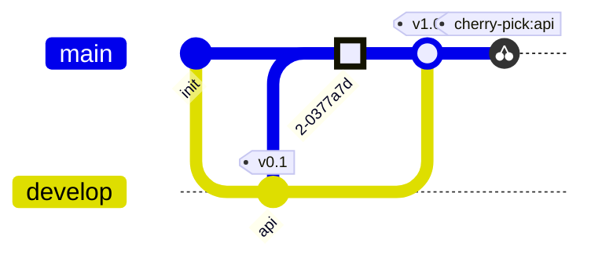

# Git-Graph

Commits in der geschriebenen Reihenfolge, eine Bahn pro Branch; `main`
existiert von Anfang an.

| Syntax | |
|---|---|
| `gitGraph`, `gitGraph TB:`, `gitGraph BT:` | von links nach rechts, von oben nach unten, von unten nach oben |
| `commit` | ein Commit auf dem aktuellen Branch |
| `… id: "x" msg: "…" tag: "v1" type: NORMAL\|REVERSE\|HIGHLIGHT` | seine ID (angezeigt), Nachricht (angezeigt, wenn es keine ID gibt), Tag, Aussehen |
| `branch name`, `… order: 2` | ein neuer Branch vom aktuellen Commit, wird aktuell; `order` setzt seine Bahn |
| `checkout name`, `switch name` | der aktuelle Branch |
| `merge name`, mit den Commit-Optionen | ein Merge-Commit mit zwei Eltern |
| `cherry-pick id: "x"` | eine Kopie von Commit x auf dem aktuellen Branch |

Fehler: ein unbekannter Branch, ein Merge ohne Neues, eine doppelt
verwendete Commit-ID. Bis zu 500 Commits.
