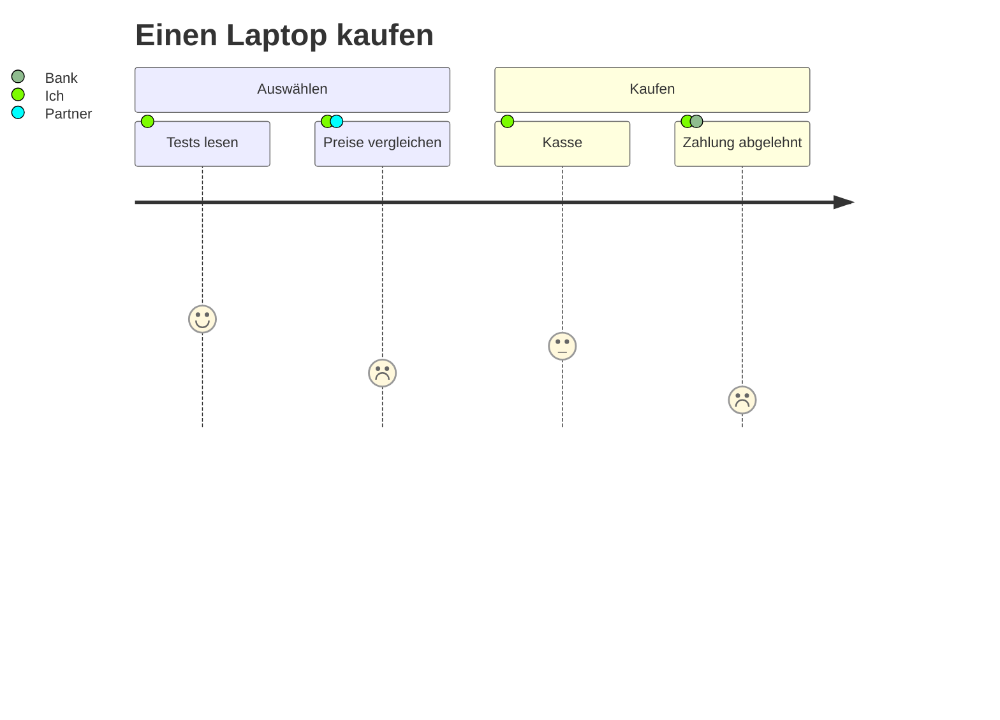

# User Journey

Eine Customer Journey Map: Schritte von links nach rechts unter ihren
Abschnitten, jeder mit einer Bewertung von 1 (schlecht) bis 5 (gut) als
Gesicht, das umso höher steht, je besser sie ist, und die Beteiligten als
farbige Punkte, in der Legende benannt.

| Syntax | |
|---|---|
| `title …` | der Titel |
| `section …` | beginnt eine Gruppe von Schritten |
| `Schritt: 5: Person, Andere` | ein Schritt, seine Bewertung (1–5) und seine Beteiligten (optional) |

Theme-Variablen: `--dg-journey-face`, `--dg-journey-face-sad` (Bewertung
1–2), `--dg-journey-face-happy` (4–5); die Farben der Abschnitte kommen aus
der Palette (`--dg-pie-1` …).
