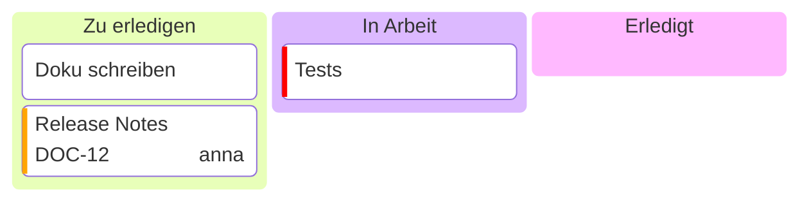

# Kanban-Board

| Syntax | |
|---|---|
| `id[Titel]` auf der äußeren Einrückung | eine Spalte |
| `id[Text]`, `[Text]` oder Text, unter einer Spalte eingerückt | eine Karte |
| `@{ assigned: 'name', ticket: KEY-1, priority: 'High' }` | Kartendaten; Priorität ist `Very High`, `High`, `Low` oder `Very Low` (ein farbiger Streifen) |

Die Spalten stehen nebeneinander und reichen bis zur Höhe der höchsten.
