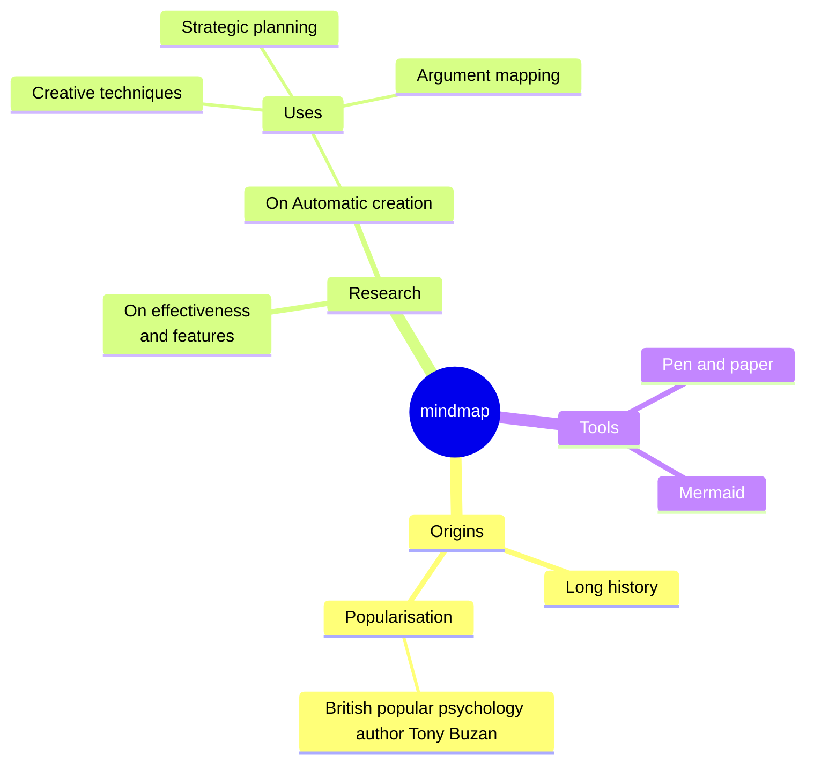

# Mindmap



`mindmap` in der ersten Zeile, dann eine Gliederung: ein Knoten pro Zeile,
verschachtelt durch Einrückung.

## Aufbau

- **Der erste Knoten ist die Wurzel.** Es gibt genau eine Wurzel: Ein
  späterer Knoten, der so wenig (oder weniger) eingerückt ist wie die Wurzel,
  ist ein Fehler, der die Wurzel nennt.
- **Der Elternknoten** eines Knotens ist der nächste Knoten darüber, der
  weniger eingerückt ist. Die Einrückung muss nicht gleichmäßig sein — `4`,
  dann `6`, dann `5` Leerzeichen funktionieren, wie in Mermaid. Jedes
  Leerraumzeichen zählt als eine Spalte, auch ein Tabulator; mischen Sie
  also keine Tabulatoren und Leerzeichen.
- `%%` beginnt einen Kommentar. `accTitle:` / `accDescr:` legen den
  barrierefreien Titel und die Beschreibung fest.

## Knotenformen

| Quelltext | Form |
|---|---|
| `Text` | Standard: eine getönte Fläche, in der Farbe des Astes unterstrichen |
| `id[Text]` | Rechteck |
| `id(Text)` | abgerundet |
| `id((Text))` | Kreis |
| `id))Text((` | Knall (bang) |
| `id)Text(` | Wolke |
| `id{{Text}}` | Sechseck |

- Die Id vor der Form ist optional: `[Text]` funktioniert auch.
- Der Text eines Knotens ohne Form ist die ganze Zeile. Eine Klammer darin
  beginnt eine Form, wie in Mermaid: `Pen (and) paper` ist ein Fehler (die
  Form `(` ist am Zeilenende nicht geschlossen). Solchen Text setzt man in
  Anführungszeichen: `id["Pen (and) paper"]` oder `"Pen (and) paper"` für
  die Standardform.
- Die Wurzel ohne Form wird als abgerundete Fläche gezeichnet.

## Beschriftungen

- `<br>` bricht die Zeile um. Beschriftungen, die breiter als 200 Pixel
  sind, werden umbrochen.
- **Markdown-Strings** — ``id["`text`"]`` — verstehen `**fett**` und
  `*kursiv*` und dürfen über mehrere Quelltextzeilen gehen; jede Zeile des
  Strings ist eine Zeile der Beschriftung:

  ```
  mindmap
      id1["`**Root** with
  a second line`"]
  ```

- Außerhalb von Markdown-Strings sind `*` und `_` gewöhnliche Zeichen.

## Icons und Klassen

`::icon(fa fa-book)` in der Zeile unter einem Knoten (oder am Ende seiner
Zeile) und `:::Klassennamen` werden akzeptiert und im geparsten Baum
behalten, aber **nicht gezeichnet**: Ein Icon braucht eine Icon-Schrift, auf
die sich das SVG nicht verlassen kann, und Mermaids Mindmaps haben kein
`classDef`, das einer Klasse eine Bedeutung gäbe. Ein für Mermaid
geschriebenes Diagramm wird daher ohne Änderungen dargestellt, nur ohne
Icons.

## Anordnung

Die Wurzel steht in der Mitte. Ihre Äste werden so auf die rechte und die
linke Seite verteilt, dass beide Seiten etwa gleich hoch sind; gelesen
werden sie im Uhrzeigersinn — die ersten Äste gehen die rechte Seite
hinunter, die übrigen kommen links wieder herauf. Jeder Ast wächst als
ordentlicher Baum nach außen: Kinder untereinander, jeder Elternknoten auf
die Mitte seiner Kinder zentriert.

Die Anordnung ist deterministisch — keine Kräftesimulation, kein Zufall —,
sodass derselbe Quelltext immer dasselbe Bild ergibt. Mermaids eigene
Anordnung ist eine andere (kräftebasiert); die Struktur ist dieselbe.

Jeder Ast der ersten Ebene bekommt eine Farbe aus `--dg-pie-1` …
`--dg-pie-12`, für seine Knoten (getönt) und seine Verbindungslinien
(gefüllt); die Wurzel verwendet `--dg-node-fill`, `--dg-node-stroke` und
`--dg-node-text`. Siehe [Gestaltung](theming.md).

Eine Mindmap darf bis zu 500 Knoten haben.
