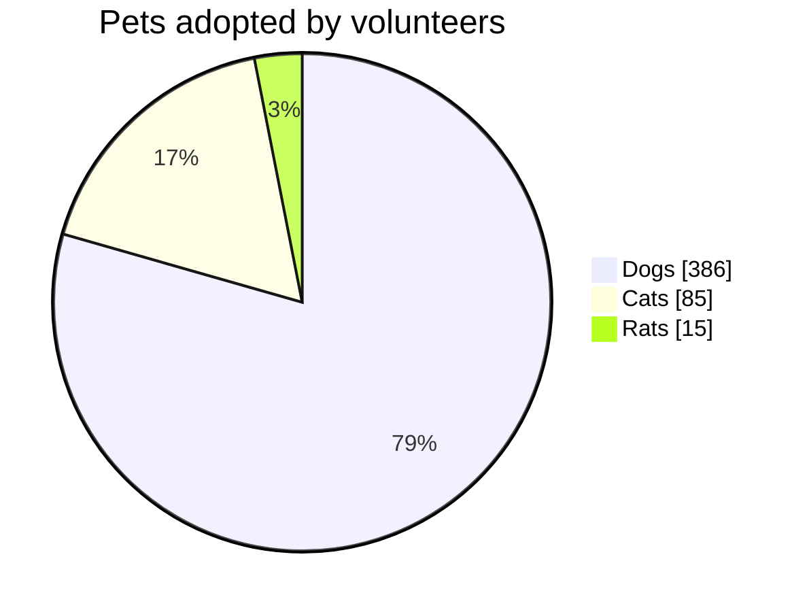

# Kreisdiagramm

- `pie`, optional gefolgt von `showData` und/oder `title …` in derselben
  Zeile.
- `title …` und `showData` können auch eigene Zeilen sein.
- Jedes Segment: eine Beschriftung in doppelten (oder einfachen)
  Anführungszeichen, ein Doppelpunkt, eine Zahl. Negative Zahlen sind ein
  Fehler; Segmente mit null werden in der Legende aufgeführt, aber nicht
  gezeichnet.
- `accTitle:` / `accDescr:` legen den barrierefreien Titel und die
  Beschreibung fest.

Segmente werden **in der geschriebenen Reihenfolge** gezeichnet, im
Uhrzeigersinn ab zwölf Uhr, sodass die Reihenfolge im Diagramm mit der
Legende und dem Quelltext übereinstimmt. Prozentwerte stehen in Segmenten ab
3 %. `showData` fügt jedem Legendeneintrag den Wert hinzu.

Die Segmentfarben sind `--dg-pie-1` … `--dg-pie-12` (zyklisch); siehe
[Gestaltung](theming.md).
