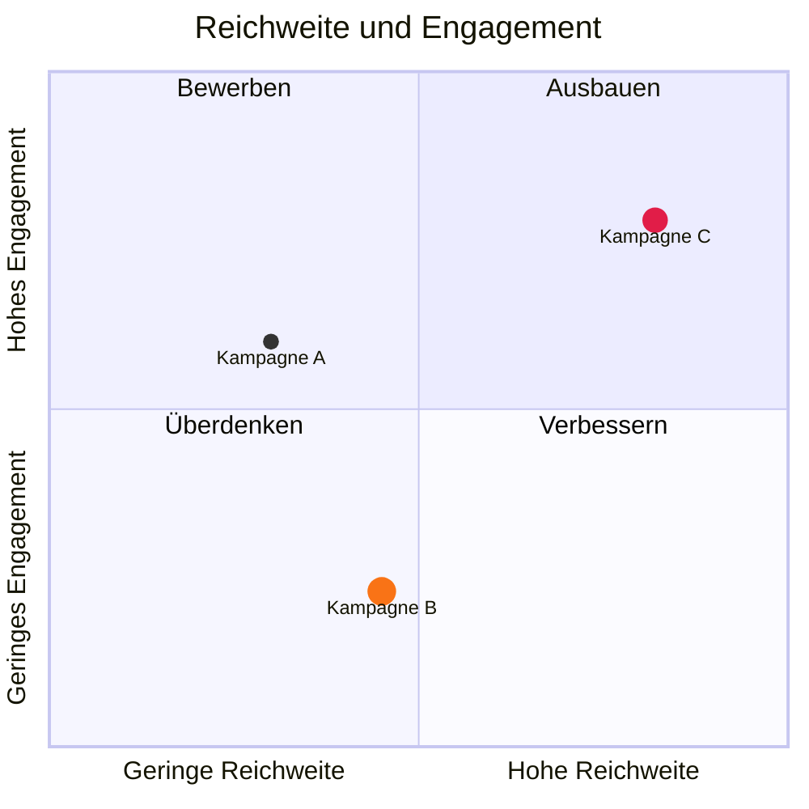

# Quadrantendiagramm

| Syntax | |
|---|---|
| `title …` | der Titel |
| `x-axis Niedrig --> Hoch`, `y-axis Niedrig --> Hoch` | Achsentexte an beiden Enden oder einer in der Mitte |
| `quadrant-1 …` … `quadrant-4 …` | Quadrantenbeschriftungen: 1 oben rechts, 2 oben links, 3 unten links, 4 unten rechts |
| `Name: [x, y]` | ein Punkt, beide Koordinaten von 0 bis 1 |
| `… radius: 9, color: #f97316, stroke-color: #fff, stroke-width: 2px` | der Stil des Punkts |
| `Name:::klasse: [x, y]`, `classDef klasse color: …, radius: …` | ein gemeinsamer Stil |

Theme-Variablen: `--dg-quadrant-1` … `--dg-quadrant-4`.
