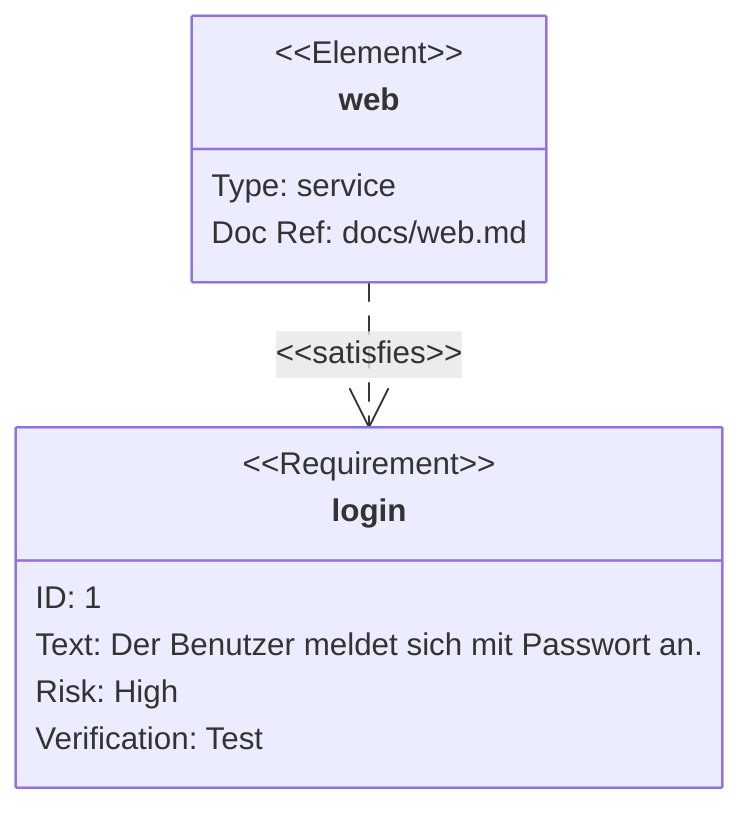

# Anforderungsdiagramm

Anforderungen und Elemente sind Kästen mit ihrer Art als Stereotyp und
ihren Feldern als Zeilen; Beziehungen sind gestrichelte Pfeile mit ihrer
Art als Beschriftung. Gezeichnet vom Renderer der Klassendiagramme
([Klassendiagramm](class.md)).

| Syntax | |
|---|---|
| `requirement`, `functionalRequirement`, `interfaceRequirement`, `performanceRequirement`, `physicalRequirement`, `designConstraint` `name { … }` | eine Anforderung mit `id`, `text`, `risk` (`low`, `medium`, `high`), `verifymethod` (`analysis`, `inspection`, `test`, `demonstration`) |
| `element name { … }` | ein Element mit `type`, `docref` |
| `a - satisfies -> b`, `b <- satisfies - a` | eine Beziehung: `contains`, `copies`, `derives`, `satisfies`, `verifies`, `refines`, `traces` |
| `direction LR`, `classDef`, `class a,b name`, `style a fill:…`, `name:::klasse` | Layout und Stile |

Ein in einer Beziehung verwendeter Name muss deklariert sein.
