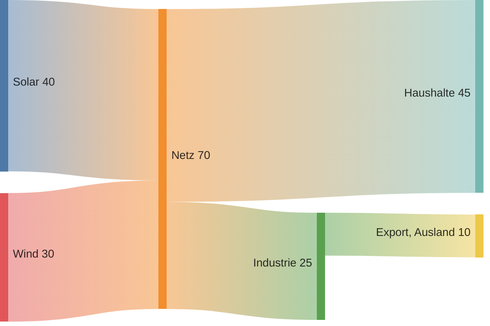

# Sankey-Diagramm

Flüsse zwischen Knoten, als Bänder so breit wie ihr Wert. Ein Fluss pro
Zeile: Quelle, Ziel, Wert, durch Kommas getrennt; ein Name mit Komma steht
in doppelten Anführungszeichen, `""` steht für ein Anführungszeichen darin.

Knoten stehen in Spalten: jeder eine Spalte rechts vom entferntesten
Knoten, der in ihn fließt, die letzten in der letzten Spalte. Ein Knoten ist
so hoch wie das Größere von Zu- und Abfluss. Flüsse dürfen nicht im Kreis
laufen — das ist ein Fehler. Bis zu 1 000 Flüsse.
