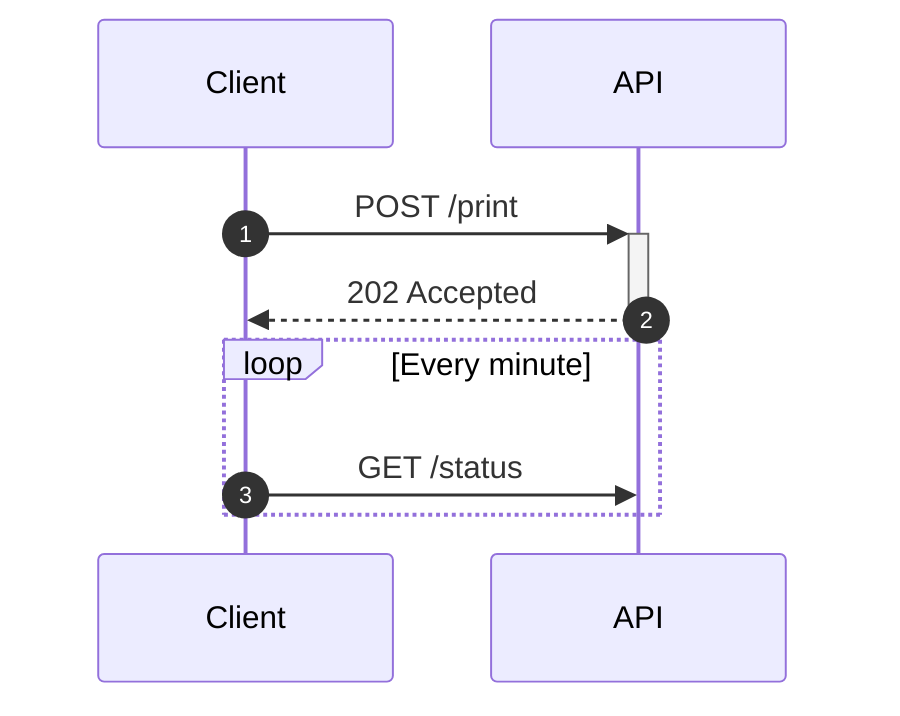

# Sequenzdiagramm



## Teilnehmer

| Syntax | Bedeutung |
|---|---|
| `participant A` | ein Kasten namens `A` |
| `participant A as Alice` | ID `A`, angezeigt als „Alice“ |
| `actor A` | ein Strichmännchen statt eines Kastens |
| `participant A@{ "type": "database" }` | ein Symbol statt eines Kastens: `boundary`, `control`, `entity`, `database`, `collections`, `queue` |
| (implizit) | ein in einer Nachricht verwendeter Name wird zum Teilnehmer |

Teilnehmer werden von links nach rechts in der Reihenfolge ihrer Deklaration
oder ersten Verwendung platziert. `<br>` bricht eine Beschriftung um.

**Boxen** fassen Teilnehmer auf einem gemeinsamen Hintergrund zusammen:

```
box Lavender Backend
    participant A as API
    participant W as Worker
end
```

Die Farbe (ein Name, `#hex`, `rgb()` …) und die Beschriftung sind beide
optional. In eine Box gehören nur Teilnehmerdeklarationen; Boxen lassen sich
nicht verschachteln.

**Erzeugen und Zerstören.** `create participant B` vor der Nachricht, an der
`B` zuerst beteiligt ist, zeichnet `B` dort statt oben. `destroy B` beendet
die Lebenslinie von `B` mit einem Kreuz bei der nächsten Nachricht, an der
`B` beteiligt ist.

## Nachrichten

`A->>B: text`. Die Pfeile:

| Pfeil | Linie | Spitze |
|---|---|---|
| `->` | durchgezogen | keine |
| `-->` | gepunktet | keine |
| `->>` | durchgezogen | Pfeil |
| `-->>` | gepunktet | Pfeil |
| `-x` | durchgezogen | Kreuz |
| `--x` | gepunktet | Kreuz |
| `-)` | durchgezogen | offen (asynchron) |
| `--)` | gepunktet | offen (asynchron) |
| `<<->>` | durchgezogen | Pfeile an beiden Enden |
| `<<-->>` | gepunktet | Pfeile an beiden Enden |

Eine Nachricht eines Teilnehmers an sich selbst wird als Schleife rechts
gezeichnet.

**Aktivierungen.** `A->>+B: text` aktiviert `B`; `B-->>-A: text` beendet
die Aktivierung von `B`. `activate B` und `deactivate B` tun dasselbe in
eigenen Zeilen. Aktivierungen lassen sich verschachteln und werden versetzt
gezeichnet. Einen nicht aktiven Teilnehmer zu deaktivieren ist ein Fehler.

**Nummerierung.** `autonumber` nummeriert die folgenden Nachrichten;
`autonumber 10`, `autonumber 10 5` legen Start und Schrittweite fest;
`autonumber off` beendet die Nummerierung.

## Notizen

```
Note right of A: text
Note left of A: text
Note over A: text
Note over A,B: spans both
```

Lange Notizen werden umbrochen.

## Blöcke

```
loop Every minute
    …
end

alt Success
    …
else Failure
    …
end

opt Optional
    …
end

par Alice to Bob
    …
and Alice to John
    …
end

critical Establish a connection
    …
option Timeout
    …
end

break When the request fails
    …
end

rect rgb(200, 220, 255)
    …
end
```

Blöcke lassen sich verschachteln. `else`, `and` und `option` außerhalb ihres
Blocks sind Fehler, ebenso ein `end` ohne zu schließenden Block oder ein offen
gelassener Block. `rect` nimmt eine Farbe und zeichnet einen Hintergrund
hinter seine Nachrichten.

## Sonstiges

`title …`, `accTitle:`, `accDescr:`, `%%`-Kommentare.

## Nicht unterstützt

- Metadaten `participant A@{ … }` (Mermaid 11) — ein Fehler.
- `link`, `links`, `properties`, `details` — sie benötigen Popup-Menüs, die
  ein statisches SVG nicht hat.
- Eine Box innerhalb eines Blocks oder verschachtelte Boxen (Mermaid erlaubt
  diese ebenfalls nicht).
