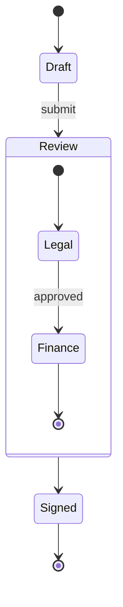

# Zustandsdiagramm



## Kopfzeile

`stateDiagram-v2` oder `stateDiagram` — die Syntax ist dieselbe. `direction
TB|BT|LR|RL` in einer eigenen Zeile legt die Richtung fest (standardmäßig von
oben nach unten).

## Zustände

| Syntax | Bedeutung |
|---|---|
| `Moving` | ein Zustand, benannt nach seiner ID |
| `state "Long name" as s1` | ein Zustand mit Anzeigenamen |
| `s1 : description` | eine Beschreibungszeile; für weitere Zeilen wiederholen |
| `state s1 : description` | dasselbe |
| `[*]` | Start (als Quelle) oder Ende (als Ziel) |

Ein Zustand mit Beschreibungen wird mit dem Namen oben, einer Trennlinie und
den Beschreibungszeilen darunter gezeichnet.

## Übergänge

`A --> B` und `A --> B : event`. `[*] --> A` startet, `A --> [*]` endet.

## Zusammengesetzte Zustände

```
state Review {
    [*] --> Legal
    Legal --> [*]
}
```

`state Name {` … `}` (oder `state "Title" as Name {`) verschachtelt Zustände;
zusammengesetzte Zustände lassen sich weiter verschachteln. `[*]` innerhalb
eines zusammengesetzten Zustands ist dessen eigener Start und eigenes Ende.
Übergänge können auf einen zusammengesetzten Zustand zeigen; sie enden an
seinem Rahmen. `direction` innerhalb eines zusammengesetzten Zustands legt
dessen eigene Richtung fest, wenn kein Zustand darin mit einem Zustand
außerhalb verbunden ist (wie in Mermaid).

**Nebenläufige Regionen.** `--` in einer eigenen Zeile innerhalb eines
zusammengesetzten Zustands teilt ihn in Regionen, die nebeneinander mit
gestrichelten Rahmen gezeichnet werden:

```
state Active {
    [*] --> NumLockOff
    NumLockOff --> NumLockOn : press
    --
    [*] --> CapsLockOff
    CapsLockOff --> CapsLockOn : press
}
```

## Pseudozustände

```
state check <<choice>>
state split <<fork>>
state merge <<join>>
```

Eine Auswahl ist eine kleine Raute; Gabelung und Vereinigung sind Balken quer
zum Fluss.

## Notizen

```
note right of Draft : Edited by the author
note left of Review
    Two lines
    of text
end note
```

In Layouts von oben nach unten stehen Notizen links oder rechts ihres
Zustands; in Layouts von links nach rechts — wo „links von“ die Notiz auf den
eingehenden Übergang setzen würde — platziert `left of` sie darüber und
`right of` darunter. Eine Notiz an einem zusammengesetzten Zustand wird mit
dessen Rahmen verbunden.

## Stile

`classDef`, `class a,b name`, `state:::name` und `style id …` funktionieren
wie in [Flussdiagrammen](flowchart.md#stile-und-klassen), mit denselben
geprüften Eigenschaften.

## Nicht unterstützt

- `click` auf Zuständen.
- Markdown-Strings in Zustandsnamen.
