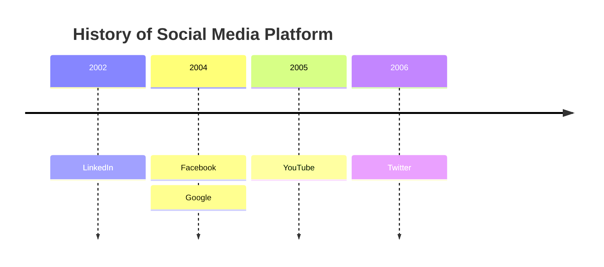
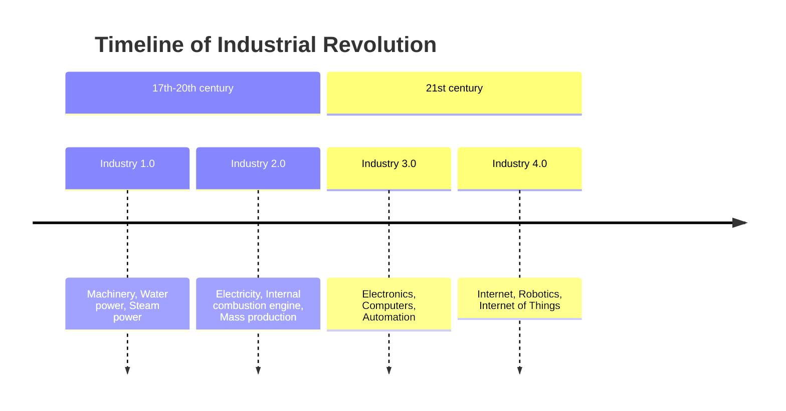

# Zeitleiste

- `timeline` in der ersten Zeile. `timeline LR` wird als dasselbe
  akzeptiert; `timeline TD` (eine senkrechte Zeitleiste) ist ein Fehler.
- `title …` setzt einen Titel über die Zeitleiste.
- **Ein Zeitraum** steht in einer eigenen Zeile: der Text des Zeitraums,
  dann seine Ereignisse, jedes nach `: `. `2004 : Facebook : Google` ist ein
  Zeitraum mit zwei Ereignissen. Ein Zeitraum darf auch keine Ereignisse
  haben.
- **Eine Zeile, die mit `:` beginnt**, fügt dem Zeitraum darüber Ereignisse
  hinzu, so lässt sich eine lange Liste mit einem Ereignis pro Zeile
  schreiben.
- Das Trennzeichen ist ein Doppelpunkt, **auf den ein Leerzeichen folgt**
  (oder der die Zeile beendet). Ein Doppelpunkt innerhalb eines Wortes bleibt
  Text: `10:30 : Stand-up at 10:30` ist der Zeitraum `10:30` mit dem Ereignis
  `Stand-up at 10:30`.
- `section …` beginnt eine Gruppe: Die folgenden Zeiträume bis zum nächsten
  Abschnitt gehören zu ihr. Zeiträume vor dem ersten Abschnitt gehören zu
  keinem.
- ` ` bricht in jedem Text die Zeile um; lange Texte werden auf die
  Spaltenbreite umbrochen.
- `%%` beginnt einen Kommentar. `accTitle:` / `accDescr:` legen den
  barrierefreien Titel und die Beschreibung fest.

Ein leeres Ereignis (`2024 : a :  : b`), Ereignisse vor dem ersten Zeitraum
und ein Abschnitt ohne Namen sind Fehler mit Zeile und Spalte.

## Abschnitte

Jeder Abschnitt ist ein Kopf über seinen Zeiträumen. Ein Abschnitt ohne
Zeiträume bekommt trotzdem einen Kopf von einer Spalte Breite, damit nichts
Geschriebenes verloren geht.

## Darstellung

Die Zeiträume stehen über einem waagerechten Pfeil, je eine Spalte, von
links nach rechts in der geschriebenen Reihenfolge; die Ereignisse eines
Zeitraums sind unter dem Pfeil gestapelt und mit ihm durch eine gestrichelte
Linie verbunden. Die Spalten haben eine feste Breite, sodass die Zeiträume
unabhängig von der Textlänge in einer Reihe stehen.

Die Farben folgen Mermaid. **Ohne Abschnitte** hat jeder Zeitraum seine
eigene Farbe und ist damit gefüllt, seine Ereignisse in derselben Farbe
heller getönt. **Mit Abschnitten** gehört die Farbe dem Abschnitt: Der Kopf
ist gefüllt, seine Zeiträume und Ereignisse sind getönt. Die Farben werden
der Reihe nach aus `--dg-pie-1` … `--dg-pie-12` genommen, Text auf gefüllten
Flächen ist `--dg-pie-text`; siehe [Gestaltung](theming.md).

Nicht unterstützt: Mermaids Einstellung `disableMulticolor` und senkrechte
Zeitleisten. Grenzen: bis zu 200 Zeiträume und 1000 Ereignisse.
