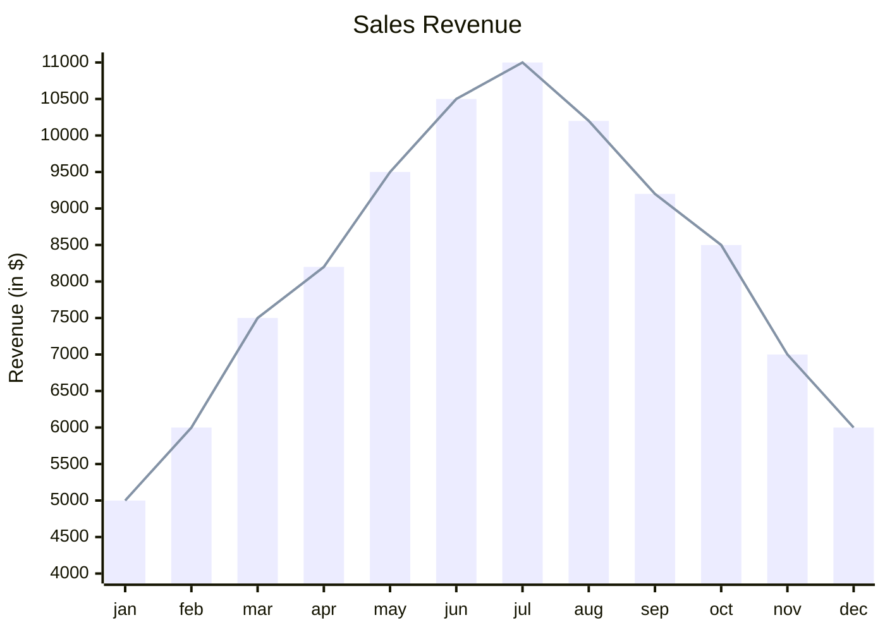

# XY-Diagramm

Die erste Zeile ist `xychart-beta` (der Name in Mermaid) oder `xychart`,
optional gefolgt von `horizontal` (oder `vertical`, der Standard).

## Anweisungen

| Anweisung | Bedeutung |
|---|---|
| `title "Text"` | Titel über dem Diagramm; Anführungszeichen sind optional |
| `x-axis [a, b, "c d"]` | eine kategoriale x-Achse: eine Kategorie pro Punkt |
| `x-axis "Titel" [a, b]` | dasselbe mit Achsentitel |
| `x-axis "Titel" 0 --> 100` | eine numerische x-Achse: Die Punkte liegen gleichmäßig zwischen 0 und 100 |
| `x-axis "Titel"` | nur ein Titel: Die Punkte werden 1, 2, 3 … nummeriert |
| `y-axis "Titel" 0 --> 100` | die Werteachse mit ihrem Bereich |
| `y-axis "Titel"` / `y-axis 0 --> 100` | nur Titel oder nur Bereich |
| `bar [1, 2, 3]` | eine Balkenreihe |
| `line [1, 2, 3]` | eine Linienreihe |
| `bar "Name" [1, 2, 3]` | eine benannte Reihe: Benannte Reihen stehen in einer Legende |

- **Titel** stehen in doppelten Anführungszeichen oder sind einfache Wörter:
  `x-axis Months [jan, feb]`. Ein Markdown-String ``"`text`"`` wird als
  einfacher Text gelesen.
- **Kategorien** werden durch Kommas getrennt; eine Kategorie mit Komma oder
  mit Leerzeichen an den Enden steht in doppelten Anführungszeichen. ` `
  bricht eine Kategoriebeschriftung um.
- **Werte** sind einfache Zahlen: `12`, `-3.5`, `.25`, `1e3`. Negative Werte
  werden von null aus nach unten gezeichnet.
- Beliebig viele Reihen, Balken und Linien gemischt. Balken mehrerer Reihen
  stehen innerhalb ihrer Kategorie nebeneinander; Linien werden über die
  Balken gezeichnet.
- Ohne `x-axis` werden die Punkte ab 1 nummeriert.
- `%%` beginnt einen Kommentar. `accTitle:` / `accDescr:` legen den
  barrierefreien Titel und die Beschreibung fest.

**Jede Reihe hat einen Wert pro Punkt**: so viele Werte wie Kategorien, auf
einer numerischen oder fehlenden x-Achse so viele wie die erste Reihe.
Mermaid verwirft überzählige Werte stillschweigend und lässt fehlende leer;
hier ist eine Abweichung ein Fehler in der Zeile der Reihe, sodass das
Diagramm nie weniger Punkte zeigt als geschrieben. Ungültige Zahlen, ein
Bereich, dessen Ende nicht größer als sein Anfang ist, eine doppelt
deklarierte Achse und unbekannte Anweisungen sind Fehler mit Zeile und
Spalte.

## Achsen

**Die Werteachse** verwendet den geschriebenen Bereich genau so. Ohne ihn
wird der Bereich aus den Daten genommen und auf ganze Teilstriche erweitert
— und wenn es Balken gibt, schließt er immer null ein, denn ein Balken, der
nicht bei null beginnt, gibt seinen Wert falsch wieder. (Mermaid beginnt
Balken beim kleinsten Wert.) Werte außerhalb eines geschriebenen Bereichs
werden am Rand der Zeichenfläche abgeschnitten.

**Teilstriche** liegen auf dem 1-, 2-, 2,5- oder 5-Fachen einer
Zehnerpotenz, auf einer senkrechten Achse etwa alle 45 Pixel. Die
Beschriftungen einer Achse teilen ein Format: so viele Nachkommastellen, wie
der Schritt braucht, ein echtes Minuszeichen und ab zehntausend eine
Einheit — `15k`, `2.5M`, `1B`, `1T`.

**Kategoriebeschriftungen**, die nicht in ihr Band passen, werden in einem
senkrechten Diagramm um 45 Grad geneigt; in einem waagerechten werden sie
rechtsbündig gesetzt und umbrochen.

## Waagerechte Diagramme

```mermaid
xychart-beta horizontal
    title "Time to first byte by region"
    x-axis Region ["North America", "Western Europe", "South-East Asia", Oceania]
    y-axis "Milliseconds"
    bar "p50" [82, 95, 210, 230]
    bar "p95" [190, 220, 480, 520]
```

Wie in Mermaid benennt `x-axis` weiterhin die Kategorien und `y-axis` die
Werte; `horizontal` dreht nur das Bild: Die Kategorien laufen an der linken
Seite nach unten, die Werte entlang der Unterkante.

## Farben

Die Reihen nehmen ihre Farben der Reihe nach aus `--dg-pie-1` …
`--dg-pie-12`, derselben Palette wie Kreisdiagramme. Das Raster ist
`--dg-grid`, die Achsenlinie `--dg-line`, die Teilstrichbeschriftungen
`--dg-text-muted`; siehe [Gestaltung](theming.md).

Nicht unterstützt: Mermaids Diagrammkonfiguration (Breite, Höhe,
Datenbeschriftungen, eigene Paletten in `%%{init}%%`) — Direktiven werden
wie bei jedem Diagrammtyp ignoriert.
