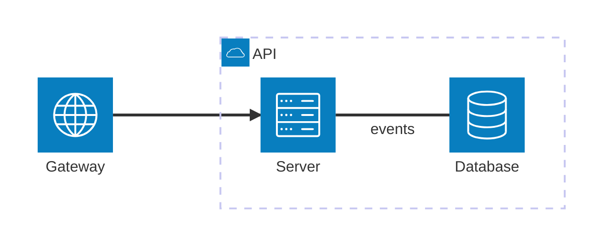

# Architecture diagram

Services with icons, grouped, with edges between them — laid out like a
[flowchart](flowchart.md), left to right.

| Syntax | |
|---|---|
| `service id(icon)[Title]`, `… in group` | a service; icons `cloud`, `database`, `disk`, `internet`, `server` (any other name, such as `aws:sqs`, draws a box) |
| `group id(icon)[Title]`, `… in group` | a group, nested in another or not |
| `junction id`, `… in group` | a point where edges meet |
| `a:R -- L:b` | an edge; the sides (`L`, `R`, `T`, `B`) are accepted, the layout routes it |
| `-->`, `<--`, `<-->` | arrowheads |
| `a:R -[text]- L:b` | an edge label |
| `a{group}:R -- L:b` | the edge starts at the group `a` is in |
