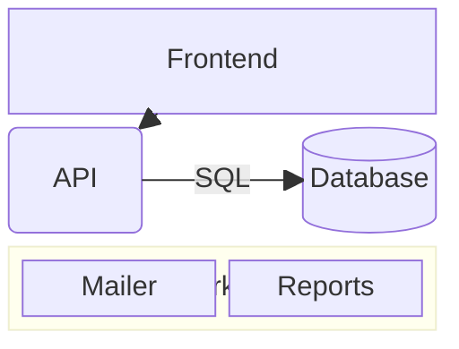

# Block diagram

Blocks placed by hand on a grid, unlike a flowchart that lays itself out.

| Syntax | |
|---|---|
| `columns 3` | the number of columns; without it, everything in one row |
| `a b c` | blocks, filling the rows left to right |
| `id:2` | a block two columns wide |
| `space`, `space:2` | empty cells |
| `a["Text"]`, `a("…")`, `a(("…"))`, `a[("…")]`, `a{"…"}`, `a{{"…"}}`, `a>"…"]`, `a[/"…"/]` … | the shapes of the [flowchart](flowchart.md) |
| `block:id["Title"]:3` … `end` | a nested grid, with its own `columns` |
| `a --> b`, `a --- b`, `a -.-> b`, `a ==> b`, `a -- "text" --> b` | edges, drawn straight between blocks or groups |
| `style a fill:…`, `classDef`, `class a name`, `a:::name` | styles |
