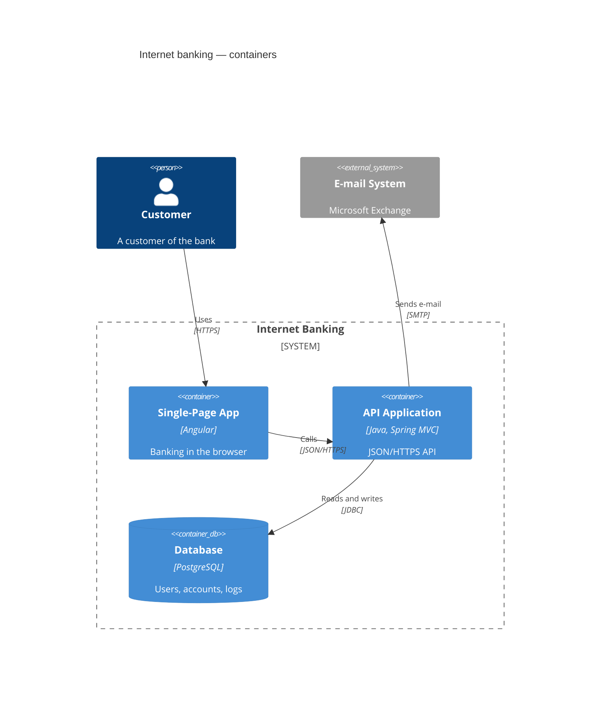

# C4 diagrams



The [C4 model](https://c4model.com) in Mermaid's syntax, which is the
syntax of C4-PlantUML: every statement is a macro call. Diagrams are drawn
in the classic C4 look — persons, blue boxes that get lighter from systems
to components, grey external elements, dashed boundaries.

## Header

One of `C4Context`, `C4Container`, `C4Component`, `C4Dynamic`,
`C4Deployment`. They share one syntax; the keyword only changes what is
numbered (see [C4Dynamic](#c4dynamic)). `title …` on its own line puts a
title above the diagram and is its accessible name; `accTitle:` and
`accDescr:` work as everywhere. Comments start with `%%`.

## Arguments

Arguments are positional or named, and can be mixed:

```
Container(api, "API", "Go", "Serves the shop")
Container(api, "API", $techn="Go", $descr="Serves the shop")
```

Values may be quoted (`"…"`, needed for commas and parentheses) or bare.
`<br>` and C4-PlantUML's `\n` break lines; longer text wraps on its own.
`$sprite`, `$tags`, `$link` and `$baseShape` are accepted and ignored — no
icons, tags or links are drawn. A named argument the macro does not have is
an error, so a typo is reported instead of silently dropped.

## Elements

| Macro | Parameters |
|---|---|
| `Person`, `Person_Ext` | alias, label, ?descr, ?sprite, ?tags, ?link |
| `System`, `SystemDb`, `SystemQueue` (+ `_Ext`) | alias, label, ?descr, ?sprite, ?tags, ?link |
| `Container`, `ContainerDb`, `ContainerQueue` (+ `_Ext`) | alias, label, ?techn, ?descr, ?sprite, ?tags, ?link |
| `Component`, `ComponentDb`, `ComponentQueue` (+ `_Ext`) | alias, label, ?techn, ?descr, ?sprite, ?tags, ?link |

Every element shows its label in bold, a type line — `[Person]`,
`[Software System]`, `[Container: technology]`, `[Component: technology]`,
with `External` in front for `_Ext` — and its description. `$type="…"` on
a person or system replaces the type line. `…Db` elements are cylinders,
`…Queue` elements are pipes lying on their side. Aliases must be unique.

## Boundaries

```
Enterprise_Boundary(corp, "Big Bank plc") {
    System_Boundary(bank, "Internet Banking") {
        Container(api, "API", "Java")
    }
    Boundary(team, "Payments team", "squad") {
        Component(pay, "Payments", "Spring Bean")
    }
}
```

| Macro | Parameters | Type line |
|---|---|---|
| `Boundary` | alias, label, ?type, ?tags, ?link | `[type]` when given |
| `Enterprise_Boundary` | alias, label, ?tags, ?link | `[Enterprise]` |
| `System_Boundary` | alias, label, ?tags, ?link | `[Software System]` |
| `Container_Boundary` | alias, label, ?tags, ?link | `[Container]` |

Boundaries nest to any depth. The body is `{ … }`; the opening brace may be
on the next line, and `{}` is an empty boundary. Boundaries are dashed
frames with the label and type at the top left. A relation may point to a
boundary: it ends at its frame.

## Deployment nodes

```
Deployment_Node(dc, "Big Bank plc", "Data centre") {
    Node(api, "bigbank-api x8", "Ubuntu 22.04") {
        Container(app, "API Application", "Java and Spring MVC")
    }
}
```

`Deployment_Node`, `Node`, `Node_L`, `Node_R` (and `Deployment_Node_L`,
`Deployment_Node_R`): alias, label, ?type, ?descr, ?sprite, ?tags, ?link.
They nest like boundaries and are drawn as solid frames that get slightly
darker with each level. `_L` and `_R` are alignment hints in PlantUML and
are drawn like `Node` here.

## Relations

| Macro | Arrow | Layout hint |
|---|---|---|
| `Rel(from, to, label, ?techn, ?descr)` | at `to` | — |
| `BiRel(…)` | at both ends | — |
| `Rel_Back(from, to, …)` | at `from` | — |
| `Rel_D` / `Rel_Down` | at `to` | `to` below `from` |
| `Rel_U` / `Rel_Up` | at `to` | `to` above `from` |
| `Rel_R` / `Rel_Right` | at `to` | `to` right of `from` |
| `Rel_L` / `Rel_Left` | at `to` | `to` left of `from` |
| `BiRel_U`, `BiRel_D`, `BiRel_L`, `BiRel_R` (and long forms) | at both ends | as above |
| `RelIndex(index, from, to, label, …)` | at `to` | — |
| `Lay_U`, `Lay_D`, `Lay_L`, `Lay_R` (and long forms) | not drawn | as above |

Relations are dashed lines with the label on the line and the technology
under it in brackets, `$descr` in italics below. They may come before the
elements they connect. A relation between an element and a boundary that
contains it is an error.

**Layout.** As in Mermaid, every scope — the diagram, each boundary, each
deployment node — places what it contains on a grid: elements in rows of
`$c4ShapeInRow` (default 4), then boundaries in rows of `$c4BoundaryInRow`
(default 2), and each frame is sized to its content. Within that grid,
items that are related are moved next to each other, so most relations
become short straight lines; with no relations the declaration order is
kept. The hints place an item in the cell above (`Rel_U`), below
(`Rel_D`), left of (`Rel_L`) or right of (`Rel_R`) the item it is related
to; between elements in different frames the hint applies to the frames.
`Lay_*` gives the same hints without drawing anything.

Relations are routed afterwards as horizontal and vertical runs: they
leave and enter square to the nearest side, go around every element they
do not connect and every frame that holds neither end, never through a
frame title, and avoid running along another relation. Each label sits on
its relation near the middle, clear of elements, titles and other labels;
when there is no such place, the grid gets wider gaps.

`LAYOUT_LEFT_RIGHT()` (or `LAYOUT_LANDSCAPE()`) fills columns instead of
rows. `LAYOUT_TOP_DOWN()` is the default.

## C4Dynamic

In a `C4Dynamic` diagram every relation is numbered in the order it is
written, the number shown in a badge in front of the label. `RelIndex`
sets the number itself — `RelIndex(5, a, b, "…")` shows 5 and continues
with 6; a non-numeric index such as `"2a"` is shown as written.
`Index()` takes the next number and `LastIndex()` repeats the last one.
In the other C4 diagrams only `RelIndex` shows a number.

## Styles and layout

```
UpdateElementStyle(customer, $bgColor="grey", $fontColor="white", $borderColor="black")
UpdateBoundaryStyle(bank, $borderColor="#b91c1c")
UpdateRelStyle(customer, spa, $textColor="blue", $lineColor="blue")
UpdateLayoutConfig($c4ShapeInRow="3", $c4BoundaryInRow="1")
```

- `UpdateElementStyle` / `UpdateBoundaryStyle`: `$bgColor`, `$fontColor`,
  `$borderColor`. Colours are validated (`#rgb`, `#rrggbb`, `rgb(…)`,
  `hsl(…)`, names); anything else is an error. `$shadowing`, `$shape`,
  `$sprite`, `$techn`, `$legendText`, `$legendSprite`, `$borderStyle` and
  `$borderThickness` are accepted and ignored.
- `UpdateRelStyle(from, to, …)`: `$textColor` and `$lineColor` for every
  relation from `from` to `to`. `$offsetX` and `$offsetY` are accepted and
  ignored: labels get room of their own in the layout, so offsets written
  for Mermaid's placement would only move them off their line.
- `UpdateLayoutConfig`: `$c4ShapeInRow` and `$c4BoundaryInRow`, the row
  lengths of the grid described under [layout](#relations).

## Theming

The palette is the C4 model's own: `--dg-c4-person-*`, `--dg-c4-system-*`,
`--dg-c4-container-*`, `--dg-c4-component-*` and `--dg-c4-external-*`
(`-fill`, `-stroke`, `-text`), plus `--dg-c4-boundary-*` and
`--dg-c4-node-*` for frames; see [theming](theming.md#variables). The
element colours read well on light and dark pages; boundaries, deployment
nodes and relation labels follow `--dg-text`, `--dg-text-muted`,
`--dg-line` and `--dg-edge-label-fill`, so a dark theme for the other
diagrams covers C4 too.

Elements carry `dg-c4-element`, `dg-c4-<level>` (`person`, `system`,
`container`, `component`), `dg-c4-<shape>` (`box`, `person`, `db`,
`queue`) and `dg-c4-external`, and `data-id` with the alias.

## Not supported

These are errors rather than silently ignored:

- Legends: `SHOW_LEGEND()`, `LAYOUT_WITH_LEGEND()`, `SHOW_FLOATING_LEGEND()`.
- Tags and their styles: `AddElementTag`, `AddRelTag`, `AddBoundaryTag`,
  `UpdateElementTag` and the like (`$tags` arguments are ignored instead).
- Properties: `SetPropertyHeader`, `AddProperty`, `WithoutPropertyHeader`.
- `Rel_Neighbor`, `Lay_Distance`, `LAYOUT_AS_SKETCH()`, `HIDE_STEREOTYPE()`
  and the person-sprite switches.
- PlantUML preprocessor lines (`!include`, `!define`).

Sprites and links are ignored: `$sprite` and `$link` arguments are
accepted, nothing is drawn for them.
