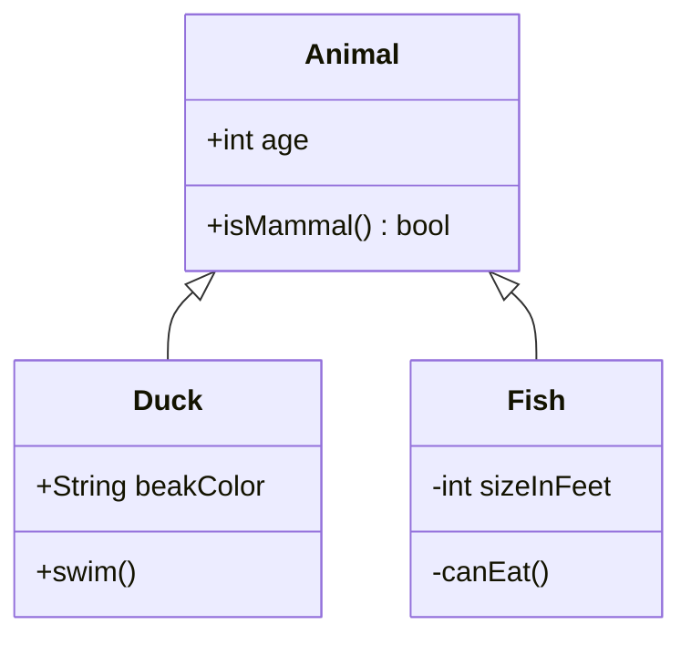

# Class diagram



## Header

`classDiagram` (or `classDiagram-v2`). `direction TB|BT|LR|RL` on its own
line sets the direction (top to bottom by default).

## Classes

| Syntax | Meaning |
|---|---|
| `class Animal` | a class |
| `class Square~T~` | a generic class, shown as `Square<T>` |
| `class Animal["Animal with a label"]` | a class with a display name |
| `class Shape <<interface>>` | a class with an annotation |
| `class Animal:::name` | the class gets the style class `name` |
| `class Duck {` … `}` | a class with a body of members |

Ids are letters (any script), digits and `_`, with `-` between them. A
class is also created by the first relationship that mentions it.

## Members

Inside a class body, one member per line; or outside it, `Class : member`:

```
class BankAccount {
    +String owner
    +BigDecimal balance$
    +deposit(amount) bool
    +withdraw(amount)* int
}
BankAccount : -List~Transaction~ history
```

A member with parentheses is a method, anything else an attribute.

- **Visibility**: a first character `+` (public), `-` (private),
  `#` (protected) or `~` (package) is kept in front of the member.
- **Return type**: the text after `)` — `+isMammal() bool` is shown as
  `+isMammal() : bool`.
- **Classifiers**: `$` at the end (or right after `)`) marks a static
  member, drawn underlined; `*` an abstract one, drawn in italics.
- **Generics**: `List~int~` is shown as `List<int>`, nested ones too:
  `Map~String, List~int~~` → `Map<String, List<int>>`.

Attributes go into the first compartment, methods into the second. A class
with no members at all is drawn as its name alone.

## Annotations

```
class Shape {
    <<interface>>
}
<<enumeration>> Color
class Service <<service>>
```

Any word between `<<` and `>>` — `interface`, `abstract`, `enumeration`,
`service` and so on — is shown above the class name as `«interface»`.

## Relationships

`A <|-- B`, `A --> B : label`, `A "1" *-- "many" B : owns`.

| Syntax | Relationship | Drawn as |
|---|---|---|
| `<\|--` | inheritance | hollow triangle |
| `*--` | composition | filled diamond |
| `o--` | aggregation | hollow diamond |
| `<--` | association | open arrow |
| `--` | link | solid line |
| `<\|..` | realization | hollow triangle, dashed |
| `<..` | dependency | open arrow, dashed |
| `..` | dashed link | dashed line |

The head may be on either end, or on both: `B --|> A`, `A *--o B`,
`A <|--|> B`. A label follows `:`; a cardinality is a quoted string next to
its class: `Customer "1" --> "*" Ticket`. A class may relate to itself;
the relationship is drawn as a loop beside it.

The layout puts the "whole" end of a relationship first — the base class
of an inheritance, the container of a composition or aggregation — so a
hierarchy reads top-down however its arrows are written.

## Namespaces

```
namespace Shapes.Base {
    class Triangle
    class Rectangle {
        double width
    }
}
```

A namespace groups class declarations in a titled frame. As in Mermaid,
only `class` declarations and annotations go inside; relationships, notes
and `Class : member` lines come after the block. Namespaces do not nest — a
dotted name (`A.B`) is the way to show a hierarchy.

## Notes

```
note for Duck "can fly\nand swim"
note "a note on its own"
```

`\n` breaks a line. A note for a class is tied to it with a dashed line; a
note without `for` stands on its own.

## Styles and links

- `classDef name fill:…,stroke:…`, `cssClass "A,B" name`, `class A:::name`
  and `style A …` work as in [flowcharts](flowchart.md#styles-and-classes),
  with the same validated properties. The fill colours the header band;
  member compartments keep their own background.
- `link A "url" "tooltip"` and `click A href "url" "tooltip" _blank` make a
  class a link — with the same filter of schemes as flowcharts.
- `callback A "fn"` and `click A call fn()` are accepted and ignored:
  scripts from the diagram text are never run.

## Comments

`%%` starts a comment, on its own line or after a statement.

## Not supported

- Lollipop interfaces (`()--`, `--()`).
- Class names in backquotes (`` class `Animal Class!` ``) — use a label:
  `class Animal["Animal Class!"]`.
- Generic parameters in relationship statements (`A~T~ <|-- B`) — declare
  the generic with `class A~T~` and refer to it as `A`.
- Nested namespaces.
- Front matter (`---` … `---`) and `title`.
