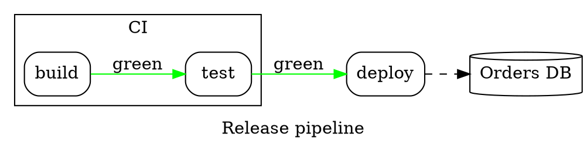

# Graphviz DOT

A source starting with `digraph`, or with `graph` followed by a body in
braces, is DOT (Mermaid's `graph TD` has no braces). `render(source, {
syntax: 'dot' })` says it explicitly. DOT is drawn with the flowchart's
layout — not Graphviz's — so the same graph looks like a flowchart here.

| Syntax | |
|---|---|
| `graph` / `digraph`, `strict` | undirected (`--`) or directed (`->`) |
| `a`, `a [label="…", shape=box]` | a node and its attributes |
| `a -> b -> c [label="…"]`, `a -> {b c}` | edge chains, to several nodes at once |
| `node [ … ]`, `edge [ … ]`, `graph [ … ]` | defaults for what follows, per subgraph |
| `rankdir=LR`, `label="…"` | direction (`TB`, `LR`, `BT`, `RL`) and a title |
| `subgraph cluster_x { label="…"; … }` | a framed cluster; a subgraph without `cluster` only groups |
| `a:port` | ports are accepted |
| `;`, newlines, `//`, `/* */`, `#` | separators and comments |

**Attributes.** Nodes: `label` (records `{a|b}` become lines; HTML labels
`<…>` lose their tags; `\n`, `\l`, `\r` break lines), `shape` (box, rect,
ellipse, oval, circle, point, doublecircle, diamond, hexagon,
parallelogram, trapezium, invtrapezium, cylinder, note, folder, tab,
component, box3d, plaintext, record, Mrecord, …), `style` (rounded, filled,
dashed, dotted, invis), `color`, `fillcolor`, `fontcolor`. Edges: `label`,
`style` (dashed, dotted, bold, invis), `color`, `penwidth`, `dir` (forward,
back, both, none), `arrowhead` and `arrowtail` (normal, vee, empty, diamond,
odiamond, dot, none, tee, …), `minlen`. Clusters: `label`, `bgcolor`,
`color`. Colours are names or `#rrggbb`; others are ignored. Layout
attributes Graphviz uses (`pos`, `rank`, `constraint`, `splines`…) are
accepted and do nothing.
