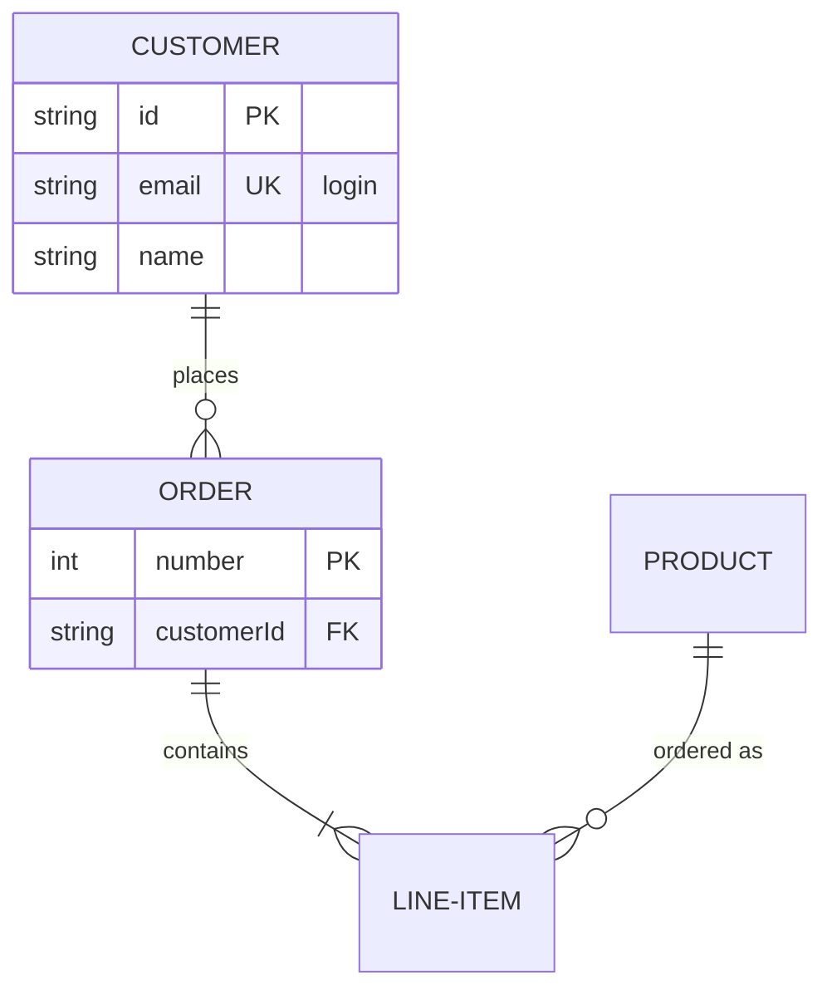

# Entity relationship diagram



## Header

`erDiagram`. `direction TB|BT|LR|RL` on its own line sets the direction
(top to bottom by default).

## Entities

| Syntax | Meaning |
|---|---|
| `CUSTOMER` | an entity, named by its id |
| `LINE-ITEM` | ids are letters (any script), digits and `_`, with `-` between them |
| `"Order line"` | any name in double quotes, spaces included |
| `p["Person"]` or `p[Person]` | an alias: the box shows "Person", relationships use `p` |
| `CUSTOMER:::name` | the entity gets the class `name` (see [Styles](#styles)) |

An entity is created by the first statement that mentions it; a
relationship is enough.

## Attributes

```
CUSTOMER {
    string id PK "the key"
    string email UK
    int orderNumber PK, FK
    decimal(10,2) total
    string[] tags
}
```

One attribute per line inside `{` … `}`: a type, a name, then optionally
keys and a comment.

- **Type**: starts with a letter, `_` or `*`; may contain `[]`, `()`, `,`
  and `-` — `decimal(10,2)`, `string[]`.
- **Name**: a word; it may start with `*`.
- **Keys**: `PK`, `FK`, `UK`, several separated by commas.
- **Comment**: text in double quotes.

The entity is drawn as a table: its name in a header band, then one row
per attribute, with type, name, keys and comment in aligned columns. An
entity without attributes is just its name. `CUSTOMER {}` declares an
empty one.

## Relationships

```
CUSTOMER ||--o{ ORDER : places
CUSTOMER }|..|{ ADDRESS : "ships to"
```

A relationship is the first entity, a cardinality, a line, a cardinality,
the second entity, and optionally `:` with a label (quoted or not).

| Left | Right | Cardinality |
|---|---|---|
| `\|\|` | `\|\|` | exactly one |
| `\|o` | `o\|` | zero or one |
| `}\|` | `\|{` | one or more |
| `}o` | `o{` | zero or more |

| Line | Meaning |
|---|---|
| `--` | identifying: a solid line |
| `..` (also `.-`, `-.`) | non-identifying: a dashed line |

Each end is drawn as crow's foot notation where the line meets the entity.
An entity may relate to itself; the relationship is drawn as a loop beside
it.

**Word forms.** Mermaid's spelled-out cardinalities work too, with `to`
(identifying) or `optionally to` (non-identifying) in place of the line:

```
CAR 1 to zero or more NAMED-DRIVER : allows
PERSON only one optionally to one or many ADDRESS : has
```

| Words | Cardinality |
|---|---|
| `only one`, `1` | exactly one |
| `zero or one`, `one or zero` | zero or one |
| `one or more`, `one or many`, `many(1)`, `1+` | one or more |
| `zero or more`, `zero or many`, `many(0)`, `0+` | zero or more |

## Styles

`classDef name fill:…,stroke:…`, `class a,b name`, `ENTITY:::name` and
`style id …` work as in [flowcharts](flowchart.md#styles-and-classes), with
the same validated properties. On an entity with attributes the fill
colours the header band; the rows keep their own background, so their text
stays readable in a dark theme.

## Comments

`%%` starts a comment, on its own line or after a statement.

## Not supported

- Attributes on the line of the opening `{`, or several on one line.
- A class (`:::`) on an entity inside a relationship statement — put it on
  a declaration.
- Front matter (`---` … `---`) and `title`.
