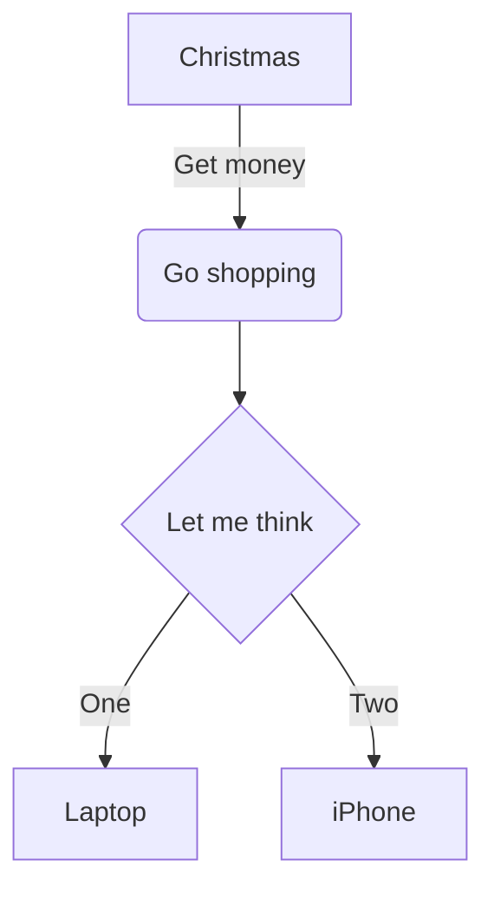
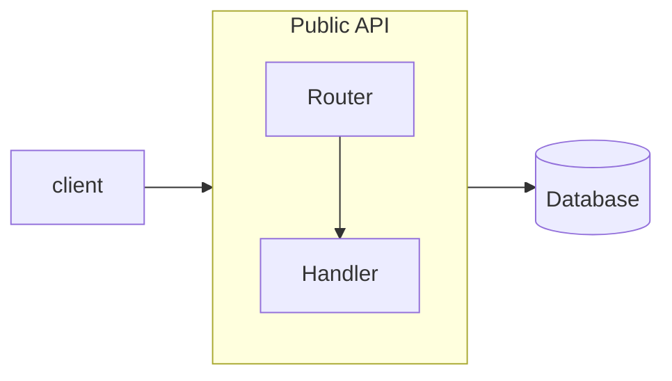

# Flowchart



## Header and direction

`flowchart` or `graph`, followed by a direction: `TB` (or `TD`, top to
bottom — the default), `BT`, `LR`, `RL`.

## Nodes

A node is an id, optionally followed by its text in a shape:

| Syntax | Shape |
|---|---|
| `id` | rectangle with the id as text |
| `id[text]` | rectangle |
| `id(text)` | rounded rectangle |
| `id([text])` | stadium |
| `id[[text]]` | subroutine |
| `id[(text)]` | cylinder (database) |
| `id((text))` | circle |
| `id(((text)))` | double circle |
| `id>text]` | asymmetric |
| `id{text}` | rhombus (decision) |
| `id{{text}}` | hexagon |
| `id[/text/]` | parallelogram |
| `id[\text\]` | parallelogram, the other way |
| `id[/text\]` | trapezoid |
| `id[\text/]` | trapezoid, the other way |

Ids are letters (any script), digits, `_`, `.`, `$`, and `-` between letters.

**Text.** Put text in double quotes to use brackets or other special
characters in it: `A["a (b) [c]"]`. `<br>` breaks a line — it is the only
HTML understood; any other markup is shown as text. Mermaid's entity codes
work: `#quot;`, `#35;`, `#x23;`.

**Markdown strings.** Text in backquotes inside quotes,
``A["`**bold** and *italic*`"]``, supports `**bold**` and `*italic*` /
`_italic_`, real line breaks, and wraps at 200 pixels.

## Edges

| Syntax | Edge |
|---|---|
| `A --> B` | arrow |
| `A --- B` | line without a head |
| `A -.-> B` / `A -.- B` | dotted |
| `A ==> B` / `A === B` | thick |
| `A --o B` | circle head |
| `A --x B` | cross head |
| `A <--> B`, `A o--o B`, `A x--x B` | heads at both ends |
| `A ~~~ B` | invisible: affects the layout, is not drawn |

**Length.** Extra strokes make an edge span more ranks: `-->` spans one,
`--->` two, `---->` three; the same for `-..->` and `===>`.

**Text on edges.** `A -->|text| B`, `A -- text --> B`, `A -. text .-> B`,
`A == text ==> B`. Quotes and markdown strings work as for nodes.

**Chains and groups.** `A --> B --> C` is two edges. `A & B --> C & D` is
four.

## Subgraphs



- `subgraph id`, `subgraph id [title]`, `subgraph "title"`, or
  `subgraph title with spaces` (the id is then the title with `_` for spaces);
  closed by `end`. Subgraphs nest.
- A node belongs to the first subgraph it is mentioned in. Mentioning it
  again at the top level does not take it out.
- Edges may point to a subgraph by its id; they end at its frame.
- `direction` inside a subgraph sets its own direction. As in Mermaid, it is
  honoured when no node inside the subgraph is linked to a node outside it
  (edges to the subgraph itself are fine). Such a subgraph is laid out on its
  own and placed as one block; a subgraph with edges crossing its frame is
  laid out together with the rest of the diagram.

## Styles and classes

```
classDef warn fill:#fde68a,stroke:#b45309,color:#78350f
classDef default stroke-width:2px
A:::warn --> B
class B,C warn
style D fill:#bbf7d0,stroke:#15803d
linkStyle 0 stroke:#dc2626,stroke-width:2px
linkStyle default stroke-dasharray:4 2
```

`classDef default` applies to every node. `linkStyle` counts edges from 0
in the order they were written.

Only these properties are accepted, with validated values — a style can
never load a URL or reach outside the diagram:

| Property | Values |
|---|---|
| `fill`, `stroke`, `color` | `#rgb`, `#rgba`, `#rrggbb`, `#rrggbbaa`, `rgb()`, `rgba()`, `hsl()`, `hsla()`, colour names |
| `stroke-width`, `font-size` | a number, optionally `px` or `em` |
| `stroke-dasharray` | numbers |
| `opacity`, `fill-opacity`, `stroke-opacity` | 0 to 1 |
| `font-weight` | `normal`, `bold`, `100`–`900` |
| `font-style` | `normal`, `italic` |

Anything else is a `DiagramError` naming the property.

## Links

```
click A href "https://example.com" "Tooltip" _blank
click B "/docs/page"
```

The node becomes a link. Allowed: `http:`, `https:`, `mailto:`, relative
addresses and anchors; anything else (`javascript:`, `data:`, …) is an
error. `_blank` adds `rel="noopener noreferrer"`. `click id callback` —
calling a JavaScript function — is ignored: nothing from the diagram text
is ever executed.

## Comments

`%%` starts a comment to the end of the line. `%%{init: …}%%` directives are
skipped.

## Not supported

- The `A@{ shape: …, label: … }` node syntax (Mermaid 11) — an error; use the
  bracket shapes.
- Edge ids (`A e1@--> B`) and edge animation.
- Font Awesome icons (`fa:fa-car` is shown as text).
- `click` callbacks (ignored, see above).
- HTML in labels other than `<br>` (shown as text).
