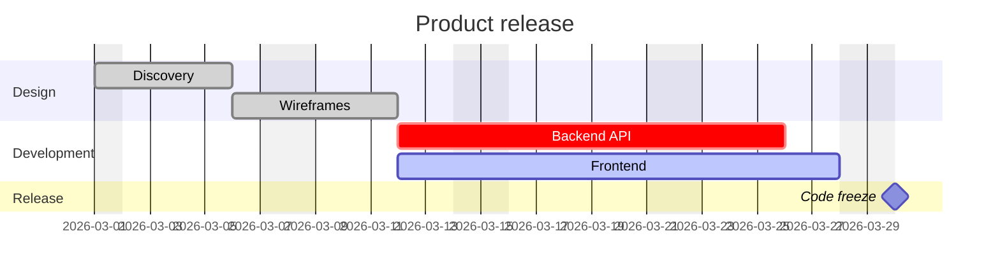

# Gantt chart



## Settings

Settings apply to the whole chart wherever they appear.

| Setting | Meaning |
|---|---|
| `title …` | title above the chart |
| `dateFormat …` | how dates in tasks are written (default `YYYY-MM-DD`) |
| `axisFormat …` | how dates on the axis are printed (strftime) |
| `tickInterval 1day` | axis step: a number and `millisecond`, `second`, `minute`, `hour`, `day`, `week` or `month` |
| `excludes …` | days that do not count: `weekends`, weekday names, dates — comma or space separated |
| `includes …` | dates that count even if excluded |
| `weekend friday` / `weekend saturday` | which two days `weekends` means (default Saturday and Sunday) |
| `inclusiveEndDates` | an end date includes that day |
| `todayMarker off` | see "Today" below |
| `topAxis` | axis on top as well |
| `section …` | starts a group of tasks |

**`dateFormat` tokens:** `YYYY`, `YY`, `MM`, `M`, `DD`, `D`, `HH`, `H`,
`mm`, `m`, `ss`, `s`, `SSS`, `X` (Unix seconds), `x` (Unix milliseconds),
and literal text in `[brackets]`. Tokens that name things — month and
weekday names, ordinals, AM/PM, time zones — are an error rather than a
guess. Dates are read as UTC, so the chart does not depend on the reader's
time zone; a date that does not match the format is an error (Mermaid falls
back to the browser's date parser, which does depend on it).

**`axisFormat` directives:** `%Y %y %m %d %e %j %b %B %a %A %u %w %H %I %M
%S %L %p %%`. Without `axisFormat` the format follows the tick step: hours
and minutes for sub-day steps, month and year for monthly ones, the date
otherwise.

## Tasks

```
Task name : [tags,] [id,] [start,] end-or-duration
```

- **Tags**, in any combination: `done`, `active`, `crit`, `milestone`.
- **Id**: a word without spaces, for `after` to refer to.
- **Start**: a date in `dateFormat`, or `after id1 id2 …` — the latest end of
  those tasks (they may be defined later in the source). Without a start, a
  task begins when the previous one ends; the first task needs one.
- **End**: a date, `until id` (when that task starts), or a duration: a
  number with `ms`, `s`, `m`, `h`, `d`, `w` (e.g. `3d`, `1.5h`, `2w`).

A task given as a duration is stretched over excluded days, as in Mermaid;
a task given an end date ends there. A milestone is drawn as a diamond at
its start.

Tasks without an id get `task1`, `task2`, … by their position in the chart.

## Links

`click id href "https://…"` makes the task a link (`http(s)`, `mailto`,
relative only).

## Today

A line for the current date would make the output depend on the clock, so
`render` draws it only when asked, with the date to use:

```ts
render(source, { today: new Date() })
```

The line appears when that date falls inside the chart. `todayMarker off`
in the source disables it even then.

## Not supported

- `displayMode compact` — every task gets its own row.
- `click id call …` — nothing from the diagram text is executed.
- `vert` markers.
- `dateFormat` tokens that name things, strftime `%U %W %Z %q`.
