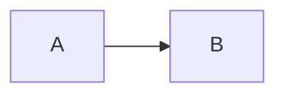

# Getting started

## Install

```bash
npm install @dskripchenko/diagrams
```

The package is an ES module with a CommonJS build beside it and its own
type definitions. It has no dependencies.

## Render a diagram

```ts
import { render } from '@dskripchenko/diagrams'

const result = render(`sequenceDiagram
  Alice->>Bob: Hello
  Bob-->>Alice: Hi`)

result.svg     // '<svg xmlns="http://www.w3.org/2000/svg" …>…</svg>'
result.width   // natural size in pixels
result.height
result.type    // 'sequence'
```

The SVG carries its own `width`, `height` and `viewBox`, and the style
`max-width:100%;height:auto`, so it shrinks to fit a narrow container and
never grows past its natural size. Put it into the page as markup:

```ts
container.innerHTML = result.svg
```

The type is taken from the first line: `flowchart` or `graph`,
`sequenceDiagram`, `stateDiagram-v2` (or `stateDiagram`), `pie`, `gantt`.

## Options

```ts
render(source, {
  measureText,  // how text is measured — see below
  idPrefix,     // prefix for ids inside the SVG
  title,        // accessible title
  today,        // gantt: draw a "today" line at this date
})
```

**`idPrefix`.** Every id inside the SVG — the root, arrowhead markers, the
scoped stylesheet — starts with this prefix. By default it is a hash of the
source, so the same diagram always gets the same ids. When the **same**
diagram is shown twice on one page, give each copy its own prefix.

**`title`.** The SVG has `role="img"` and a `<title>` for screen readers.
It is taken from this option, then from `accTitle:` in the source, then from
the diagram's own title, then from its type. `accDescr:` becomes a `<desc>`.

## Measuring text

The layout depends on how wide every label is, and that depends on the font
the reader's browser uses. Measuring is therefore a function you can replace:

- **In a browser** the default measures with a canvas (`OffscreenCanvas`
  where available), using the same font stack the SVG asks for.
- **Without a DOM** — server-side rendering, Node scripts, tests — the
  default is `approximateMeasurer`: a table of glyph widths for Latin,
  Cyrillic, digits and punctuation, with CJK characters at full width. Shapes
  are padded so that the small error does not make text overflow.

```ts
import { render, approximateMeasurer } from '@dskripchenko/diagrams'

// Identical output in every environment: use this for snapshots and caches.
render(source, { measureText: approximateMeasurer })
```

A custom measurer receives the text and a font (`size`, `family`, `weight`,
`style`) and returns `{ width, height }` in pixels.

## Errors

A source that cannot be read raises `DiagramError`:

```ts
import { render, DiagramError } from '@dskripchenko/diagrams'

try {
  render(source)
} catch (error) {
  if (error instanceof DiagramError) {
    error.line     // 1-based, 0 when the problem is the diagram as a whole
    error.column   // 1-based, 0 when unknown
    error.hint     // what to write instead, when there is an obvious answer
    error.message  // includes the position
  }
}
```

The syntax supported is a declared subset of Mermaid's, listed per type in
this documentation. Anything outside it is an error with a position — never
a picture that silently leaves something out.

## Other functions

```ts
import { detect, parse } from '@dskripchenko/diagrams'

detect('pie\n "a" : 1')   // 'pie' — or null when the first line names no known type
parse(source)             // the parsed structure, without layout: for tools and tests
```

## In a markdown renderer

The usual integration is a fenced code block:

````markdown

````

Hand the block's text to `render` and put the SVG in place of the code; on a
`DiagramError`, show the code and the message instead. With
[`@dskripchenko/ui`](https://github.com/dskripchenko/ui), `UidMarkdown`
accepts block renderers for exactly this:

```ts
import { render, DiagramError } from '@dskripchenko/diagrams'

const mermaid = (code: string) => {
  try {
    return { html: render(code).svg }
  } catch (error) {
    if (error instanceof DiagramError) return { error: error.message }
    throw error
  }
}
// <UidMarkdown :source="text" :block-renderers="{ mermaid }" />
```

The SVG is safe to insert as markup: every piece of text in it is escaped
by the package.

## Limits

A flowchart or state diagram may have up to 500 nodes and 2000 edges; beyond
that the layout's running time stops being predictable, and the render
raises `DiagramError` suggesting to split the diagram. 500 nodes lay out in
well under a second.
