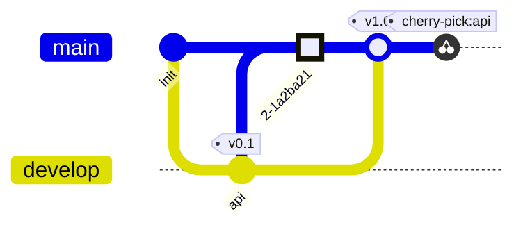

# Git graph

Commits in the order written, one lane per branch; `main` exists from the
start.

| Syntax | |
|---|---|
| `gitGraph`, `gitGraph TB:`, `gitGraph BT:` | left to right, top to bottom, bottom to top |
| `commit` | a commit on the current branch |
| `… id: "x" msg: "…" tag: "v1" type: NORMAL\|REVERSE\|HIGHLIGHT` | its id (shown), message (shown when there is no id), tag, look |
| `branch name`, `… order: 2` | a new branch from the current commit, made current; `order` places its lane |
| `checkout name`, `switch name` | the current branch |
| `merge name`, with the commit options | a merge commit with two parents |
| `cherry-pick id: "x"` | a copy of commit x on the current branch |

Errors: an unknown branch, a merge with nothing new, a commit id used twice.
Up to 500 commits.
