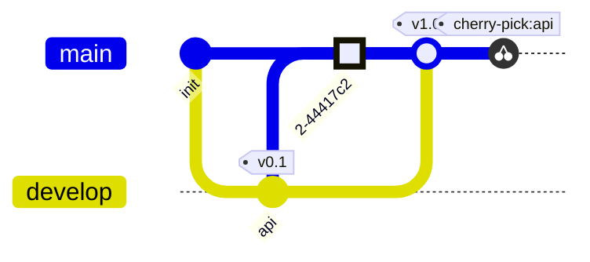

# Git graph



Commits in the order written, one lane per branch; `main` exists from the
start.

| Syntax | |
|---|---|
| `gitGraph`, `gitGraph TB:`, `gitGraph BT:` | left to right, top to bottom, bottom to top |
| `commit` | a commit on the current branch |
| `… id: "x" msg: "…" tag: "v1" type: NORMAL\|REVERSE\|HIGHLIGHT` | its id (shown), message (shown when there is no id), tag, look |
| `branch name`, `… order: 2` | a new branch from the current commit, made current; `order` places its lane |
| `checkout name`, `switch name` | the current branch |
| `merge name`, with the commit options | a merge commit with two parents |
| `cherry-pick id: "x"` | a copy of commit x on the current branch |

Errors: an unknown branch, a merge with nothing new, a commit id used twice.
Up to 500 commits.

## A commit graph beside a list

For a real history — commits read from a repository, newest first — the
graph is a column of its own, drawn to line up with a list the host renders
(messages, authors, dates): a lane per line of development, one row per
commit, curves for branch-offs and merges.

```ts
import { renderCommitGraph } from '@dskripchenko/diagrams'

const { svg, width, graph } = renderCommitGraph(
  [
    { id: 'm', parents: ['b', 'f'] }, // a merge
    { id: 'f', parents: ['a'] },
    { id: 'b', parents: ['a'] },
    { id: 'a', parents: [] },
  ],
  { rowHeight: 28, head: 'm' },
)
```

Row *k* is centred at `k × rowHeight + rowHeight / 2`, so the column sits
beside list rows of that height. A commit takes the lane that waits for it;
its first parent continues the lane, other parents get lanes of their own; a
branch runs beside its base until the commit they share and bends back in
there. Merge commits are rings, `head` gets a ring around its dot, each lane
keeps one colour of the palette (`--dg-pie-1` … `--dg-pie-12`). A parent not
in the list (a history cut short) leaves its line running to the bottom.

| Option | Default | |
|---|---|---|
| `rowHeight` | 28 | the height of a row of the list |
| `laneWidth` | 14 | the distance between lanes |
| `radius` | 4 | a commit's dot |
| `head` | — | the checked-out commit, marked |
| `id` | `dg-commits` | the `<svg>`'s id, scoping its styles |
| `title` | Commit graph | for assistive technology |

The result has `width` and `height`, `graph` — the layout (rows with their
lane and colour, the line segments) — and `laneX(lane)` to place things
beside it. `layoutCommitGraph(commits)` gives the layout alone, for a host
that draws it itself.
