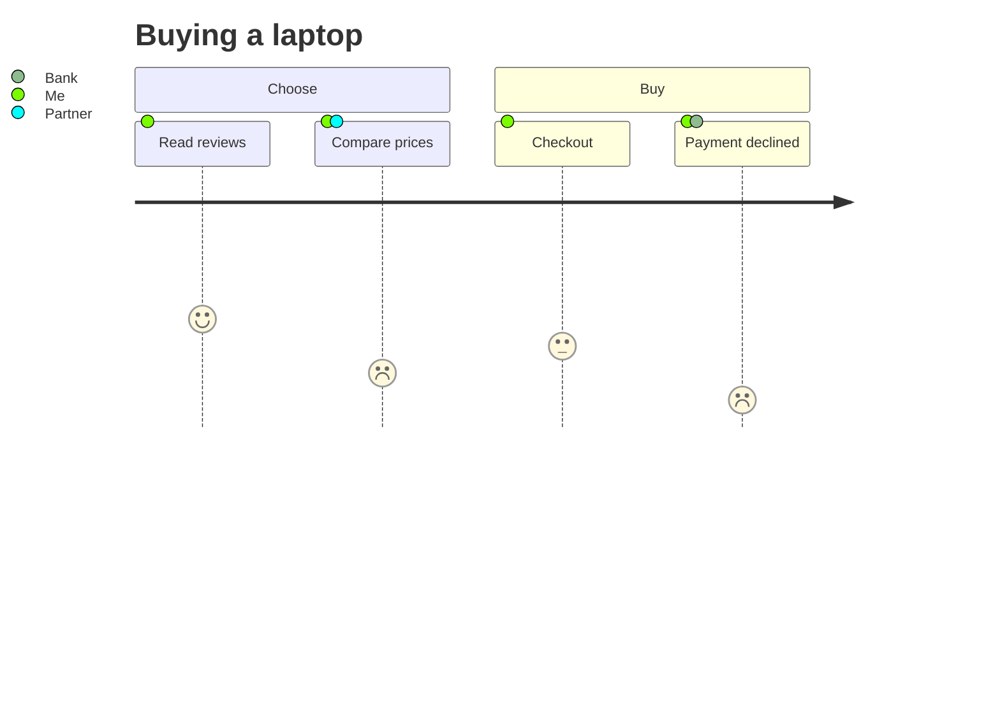

# User journey

A customer journey map: tasks left to right under their sections, each with
a score from 1 (bad) to 5 (good) drawn as a face that sits higher the better
it is, and the people taking part as coloured dots, named in the legend.

| Syntax | |
|---|---|
| `title …` | the title |
| `section …` | starts a group of tasks |
| `Task: 5: Actor, Other` | a task, its score (1–5) and its actors (optional) |

Theme variables: `--dg-journey-face`, `--dg-journey-face-sad` (scores 1–2),
`--dg-journey-face-happy` (4–5); section colours come from the palette
(`--dg-pie-1` …).
