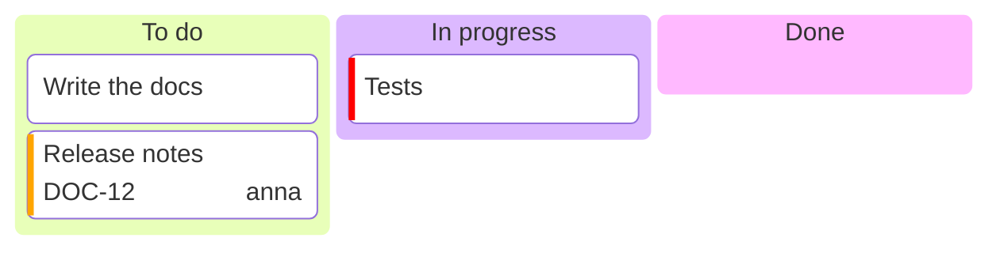

# Kanban board

| Syntax | |
|---|---|
| `id[Title]` at the outer indentation | a column |
| `id[Text]`, `[Text]` or text, indented under a column | a card |
| `@{ assigned: 'name', ticket: KEY-1, priority: 'High' }` | card metadata; priority is `Very High`, `High`, `Low` or `Very Low` (a coloured stripe) |

Columns stand side by side and reach the height of the tallest one.
