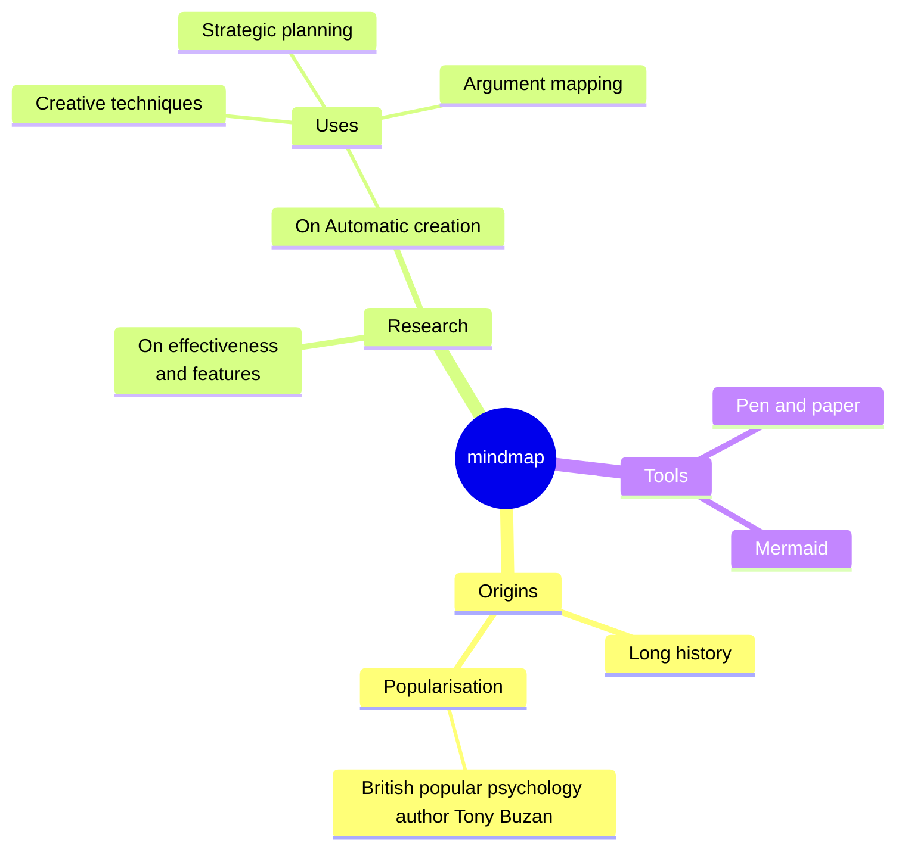

# Mind map



`mindmap` on the first line, then an outline: one node per line, nested by
indentation.

## Structure

- **The first node is the root.** There is one root: a later node indented
  as little as the root (or less) is an error that names the root.
- **A node's parent** is the nearest node above it that is indented less.
  Indentation does not have to be even — `4` then `6` then `5` spaces works,
  as in Mermaid. Every whitespace character counts as one column, a tab
  included, so do not mix tabs and spaces.
- `%%` starts a comment. `accTitle:` / `accDescr:` set the accessible title
  and description.

## Node shapes

| Source | Shape |
|---|---|
| `Text` | default: a tinted box underlined in the branch colour |
| `id[Text]` | square |
| `id(Text)` | rounded |
| `id((Text))` | circle |
| `id))Text((` | bang |
| `id)Text(` | cloud |
| `id{{Text}}` | hexagon |

- The id before the shape is optional: `[Text]` works too.
- The text of a node without a shape is the whole line. A bracket in it
  starts a shape, as in Mermaid: `Pen (and) paper` is an error (the `(` shape
  is not closed at the end of the line). Put such text in quotes:
  `id["Pen (and) paper"]`, or `"Pen (and) paper"` for the default shape.
- The root without a shape is drawn as a rounded box.

## Labels

- `<br>` breaks a line. Labels wider than 200 pixels wrap.
- **Markdown strings** — ``id["`text`"]`` — understand `**bold**` and
  `*italic*`, and may run over several source lines; each line of the string
  is a line of the label:

  ```
  mindmap
      id1["`**Root** with
  a second line`"]
  ```

- Outside markdown strings, `*` and `_` are plain characters.

## Icons and classes

`::icon(fa fa-book)` on the line under a node (or at the end of its line)
and `:::class names` are accepted and kept in the parsed tree, but **not
drawn**: an icon needs an icon font the SVG cannot rely on, and Mermaid's
mind maps have no `classDef` to give a class a meaning. A diagram written
for Mermaid therefore renders without changes, just without the icons.

## Layout

The root sits in the middle. Its branches are split between the right and
the left side so that the two sides are about equally tall; they are read
clockwise — the first branches go down the right side, the rest come back up
the left. Every branch grows outwards as a tidy tree: children stacked one
under another, each parent centred on its children.

The layout is deterministic — no force simulation, no randomness — so the
same source always gives the same picture. Mermaid's own layout differs
(it is a force-directed one); the structure is the same.

Each first-level branch takes a colour from `--dg-pie-1` … `--dg-pie-12`,
used for its nodes (tinted) and its connecting lines (solid); the root uses
`--dg-node-fill`, `--dg-node-stroke` and `--dg-node-text`. See
[theming](theming.md).

A mind map may have up to 500 nodes.
