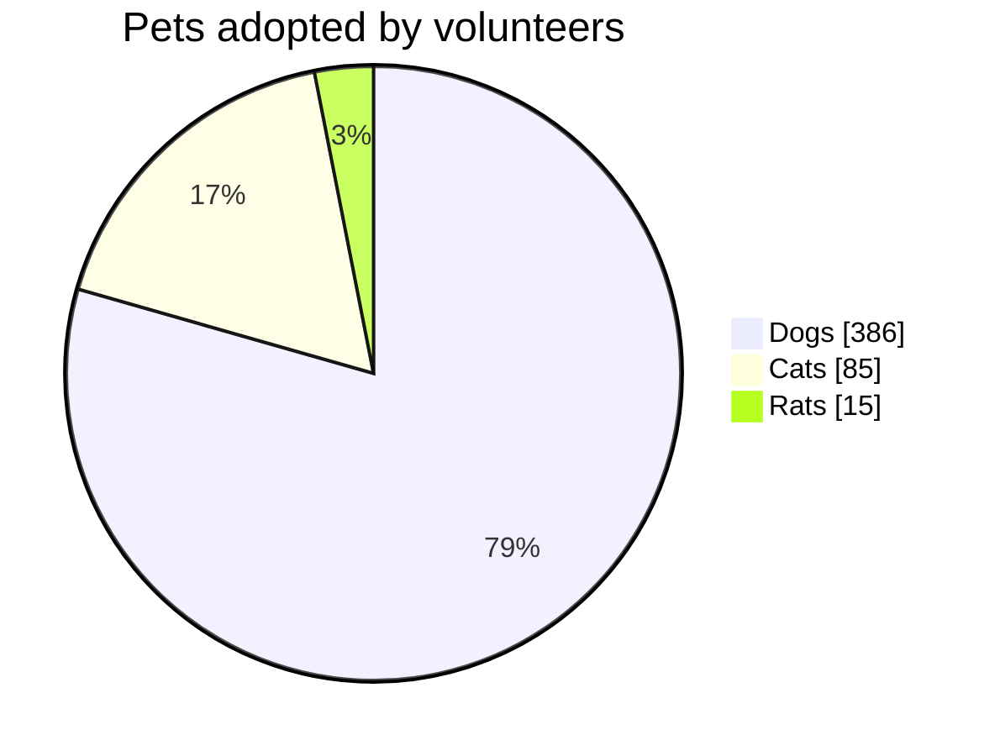

# Pie chart

- `pie`, optionally followed by `showData` and/or `title …` on the same line.
- `title …` and `showData` may also be lines of their own.
- Each slice: a label in double (or single) quotes, a colon, a number.
  Negative numbers are an error; zero slices are listed in the legend but not
  drawn.
- `accTitle:` / `accDescr:` set the accessible title and description.

Slices are drawn **in the order written**, clockwise from twelve o'clock, so
the order in the chart matches the legend and the source. Percentages are
printed inside slices of 3% and more. `showData` adds the value to each
legend entry.

Slice colours are `--dg-pie-1` … `--dg-pie-12` (cycled); see
[theming](theming.md).
