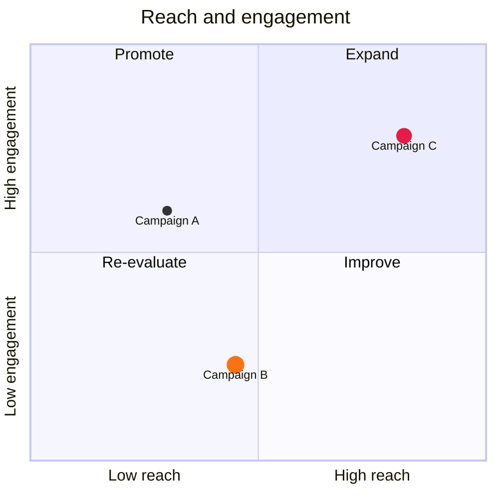

# Quadrant chart

| Syntax | |
|---|---|
| `title …` | the title |
| `x-axis Low --> High`, `y-axis Low --> High` | axis texts at both ends, or one in the middle |
| `quadrant-1 …` … `quadrant-4 …` | quadrant labels: 1 top right, 2 top left, 3 bottom left, 4 bottom right |
| `Name: [x, y]` | a point, both coordinates from 0 to 1 |
| `… radius: 9, color: #f97316, stroke-color: #fff, stroke-width: 2px` | the point's style |
| `Name:::class: [x, y]`, `classDef class color: …, radius: …` | a shared style |

Theme variables: `--dg-quadrant-1` … `--dg-quadrant-4`.
