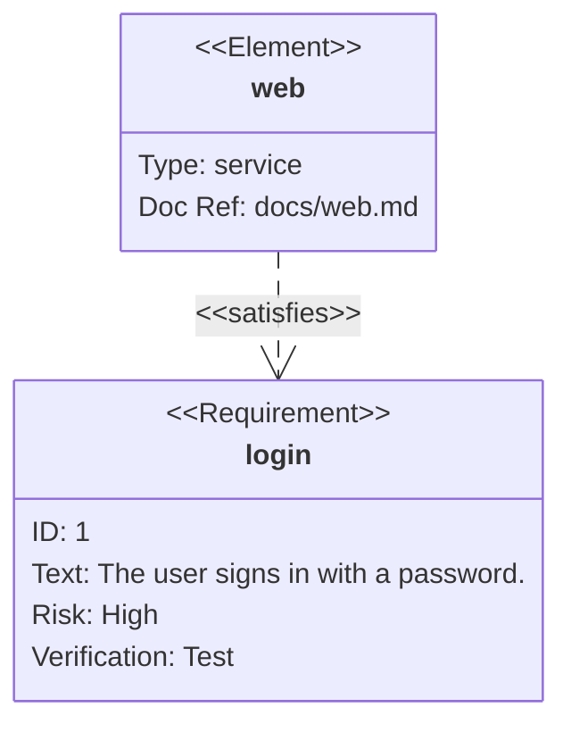

# Requirement diagram

Requirements and elements are boxes with their kind as the stereotype and
their fields as rows; relationships are dashed arrows labelled with their
kind. The class diagram's renderer draws it ([Class diagram](class.md)).

| Syntax | |
|---|---|
| `requirement`, `functionalRequirement`, `interfaceRequirement`, `performanceRequirement`, `physicalRequirement`, `designConstraint` `name { … }` | a requirement with `id`, `text`, `risk` (`low`, `medium`, `high`), `verifymethod` (`analysis`, `inspection`, `test`, `demonstration`) |
| `element name { … }` | an element with `type`, `docref` |
| `a - satisfies -> b`, `b <- satisfies - a` | a relationship: `contains`, `copies`, `derives`, `satisfies`, `verifies`, `refines`, `traces` |
| `direction LR`, `classDef`, `class a,b name`, `style a fill:…`, `name:::class` | layout and styles |

A name used in a relationship must be declared.
