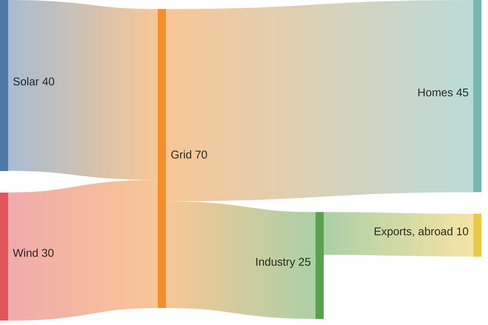

# Sankey diagram

Flows between nodes, as bands as wide as their value. One flow per line:
source, target, value, separated by commas; a name with a comma goes in
double quotes, `""` stands for a quote inside.

Nodes stand in columns: each one column right of the furthest node that
flows into it, the final ones in the last column. A node is as tall as the
larger of what flows in and what flows out. Flows must not go round in a
circle — that is an error. Up to 1 000 flows.
