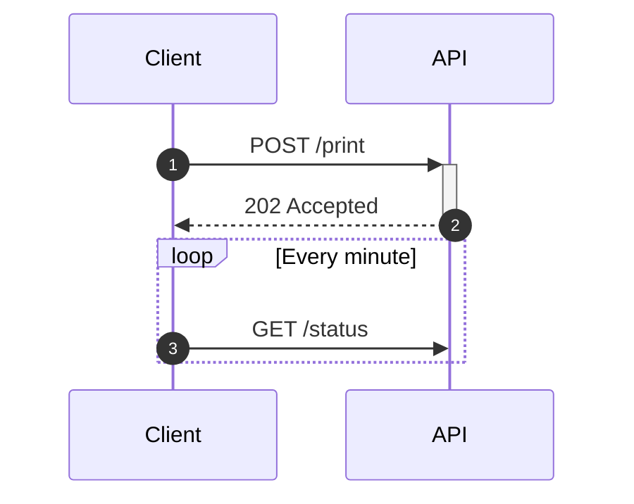

# Sequence diagram



## Participants

| Syntax | Meaning |
|---|---|
| `participant A` | a box named `A` |
| `participant A as Alice` | id `A`, shown as "Alice" |
| `actor A` | a stick figure instead of a box |
| (implicit) | a name used in a message becomes a participant |

Participants are placed left to right in the order they are declared or
first used. `<br>` breaks a label.

**Boxes** group participants under a shared background:

```
box Lavender Backend
    participant A as API
    participant W as Worker
end
```

The colour (a name, `#hex`, `rgb()` …) and the label are both optional. Only
participant declarations go inside a box; boxes do not nest.

**Creating and destroying.** `create participant B` before the message that
first involves `B` draws `B` there instead of at the top. `destroy B` ends
`B`'s lifeline with a cross at the next message involving it.

## Messages

`A->>B: text`. The arrows:

| Arrow | Line | Head |
|---|---|---|
| `->` | solid | none |
| `-->` | dotted | none |
| `->>` | solid | arrow |
| `-->>` | dotted | arrow |
| `-x` | solid | cross |
| `--x` | dotted | cross |
| `-)` | solid | open (async) |
| `--)` | dotted | open (async) |
| `<<->>` | solid | arrows at both ends |
| `<<-->>` | dotted | arrows at both ends |

A message from a participant to itself is drawn as a loop on the right.

**Activations.** `A->>+B: text` activates `B`; `B-->>-A: text` ends `B`'s
activation. `activate B` and `deactivate B` do the same on their own lines.
Activations nest and are drawn offset. Deactivating a participant that is
not active is an error.

**Numbering.** `autonumber` numbers the messages that follow;
`autonumber 10`, `autonumber 10 5` set the start and the step;
`autonumber off` stops.

## Notes

```
Note right of A: text
Note left of A: text
Note over A: text
Note over A,B: spans both
```

Long notes wrap.

## Blocks

```
loop Every minute
    …
end

alt Success
    …
else Failure
    …
end

opt Optional
    …
end

par Alice to Bob
    …
and Alice to John
    …
end

critical Establish a connection
    …
option Timeout
    …
end

break When the request fails
    …
end

rect rgb(200, 220, 255)
    …
end
```

Blocks nest. `else`, `and` and `option` outside their block are errors, as
is an `end` with no block to close or a block left open. `rect` takes a
colour and draws a background behind its messages.

## Other

`title …`, `accTitle:`, `accDescr:`, `%%` comments.

## Not supported

- `participant A@{ … }` metadata (Mermaid 11) — an error.
- `link`, `links`, `properties`, `details` — they need popup menus, which a
  static SVG does not have.
- A box inside a block, or nested boxes (Mermaid does not allow these
  either).
