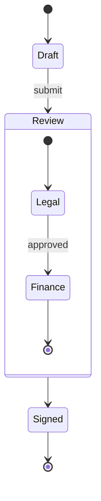

# State diagram



## Header

`stateDiagram-v2`, or `stateDiagram` — the syntax is the same. `direction
TB|BT|LR|RL` on its own line sets the direction (top to bottom by default).

## States

| Syntax | Meaning |
|---|---|
| `Moving` | a state, named by its id |
| `state "Long name" as s1` | a state with a display name |
| `s1 : description` | a description line; repeat for more lines |
| `state s1 : description` | the same |
| `[*]` | start (as a source) or end (as a target) |

A state with descriptions is drawn with its name on top, a rule, and the
description lines under it.

## Transitions

`A --> B` and `A --> B : event`. `[*] --> A` starts, `A --> [*]` ends.

## Composite states

```
state Review {
    [*] --> Legal
    Legal --> [*]
}
```

`state Name {` … `}` (or `state "Title" as Name {`) nests states; composites
nest further. `[*]` inside a composite is that composite's own start and
end. Transitions may point to a composite; they end at its frame.
`direction` inside a composite sets its own direction when no state inside
it is linked to a state outside it (as in Mermaid).

**Concurrent regions.** `--` on its own line inside a composite splits it
into regions, drawn side by side with dashed frames:

```
state Active {
    [*] --> NumLockOff
    NumLockOff --> NumLockOn : press
    --
    [*] --> CapsLockOff
    CapsLockOff --> CapsLockOn : press
}
```

## Pseudo states

```
state check <<choice>>
state split <<fork>>
state merge <<join>>
```

A choice is a small diamond; fork and join are bars across the flow.

## Notes

```
note right of Draft : Edited by the author
note left of Review
    Two lines
    of text
end note
```

In top-to-bottom layouts notes sit to the left or right of their state; in
left-to-right layouts — where "left of" would put the note on the incoming
transition — `left of` places it above and `right of` below. A note on a
composite state is connected to its frame.

## Styles

`classDef`, `class a,b name`, `state:::name` and `style id …` work as in
[flowcharts](flowchart.md#styles-and-classes), with the same validated
properties.

## Not supported

- `click` on states.
- Markdown strings in state names.
