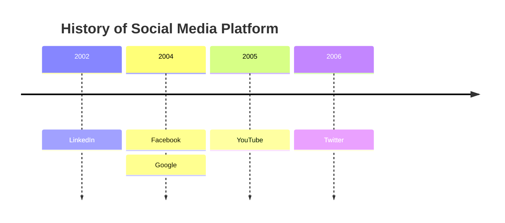
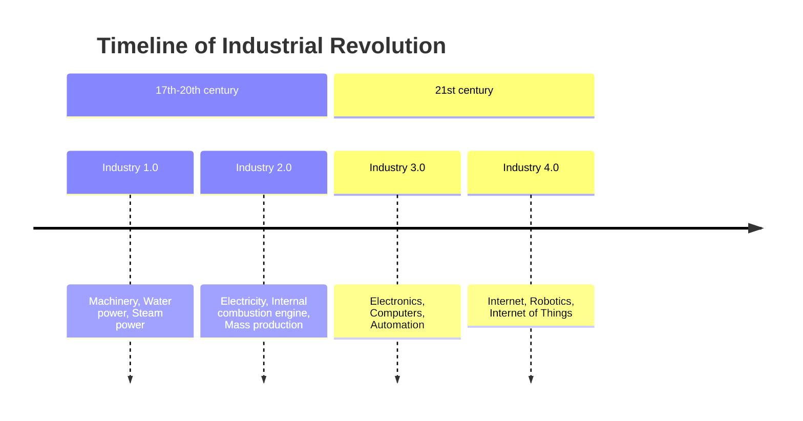

# Timeline

- `timeline` on the first line. `timeline LR` is accepted as the same thing;
  `timeline TD` (a vertical timeline) is an error.
- `title …` puts a title above the timeline.
- **A time period** is a line of its own: the period's text, then its
  events, each after `: `. `2004 : Facebook : Google` is a period with two
  events. A period may have no events at all.
- **A line that starts with `:`** adds events to the period above it, so a
  long list can be written one event per line.
- The separator is a colon **followed by a space** (or ending the line). A
  colon inside a word stays text: `10:30 : Stand-up at 10:30` is the period
  `10:30` with the event `Stand-up at 10:30`.
- `section …` starts a group: the periods after it, up to the next section,
  belong to it. Periods written before the first section belong to none.
- ` ` breaks a line in any text; long texts wrap to the column width.
- `%%` starts a comment. `accTitle:` / `accDescr:` set the accessible title
  and description.

An empty event (`2024 : a :  : b`), events before any period and a section
without a name are errors with the line and column.

## Sections

Each section is a header spanning its periods. A section with no periods
still gets a header, one column wide, so nothing written is lost.

## Drawing

Periods sit above a horizontal arrow, one column each, left to right in the
order written; each period's events are stacked under the arrow, joined to it
by a dashed line. Columns have a fixed width, so periods line up whatever the
length of their text.

Colours follow Mermaid. **Without sections** every period gets its own colour
and is drawn solid, its events tinted with the same colour. **With sections**
the colour belongs to the section: the header is solid, its periods and
events are tinted. Colours are taken in order from `--dg-pie-1` …
`--dg-pie-12`, text on solid boxes is `--dg-pie-text`; see
[theming](theming.md).

Not supported: Mermaid's `disableMulticolor` setting and vertical timelines.
Limits: up to 200 periods and 1000 events.
