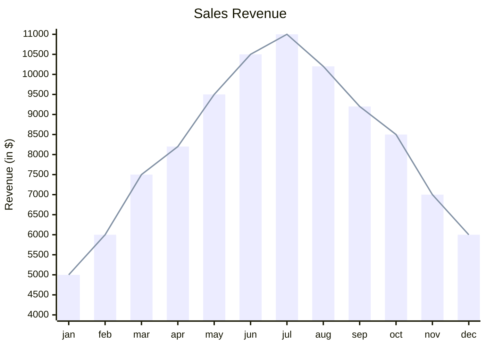

# XY chart

The first line is `xychart-beta` (Mermaid's name) or `xychart`, optionally
followed by `horizontal` (or `vertical`, the default).

## Statements

| Statement | Meaning |
|---|---|
| `title "Text"` | title above the chart; quotes are optional |
| `x-axis [a, b, "c d"]` | a categorical x axis: one category per point |
| `x-axis "Title" [a, b]` | the same with an axis title |
| `x-axis "Title" 0 --> 100` | a numeric x axis: the points are spread evenly from 0 to 100 |
| `x-axis "Title"` | a title only: the points are numbered 1, 2, 3 … |
| `y-axis "Title" 0 --> 100` | the value axis with its range |
| `y-axis "Title"` / `y-axis 0 --> 100` | title only, or range only |
| `bar [1, 2, 3]` | a bar series |
| `line [1, 2, 3]` | a line series |
| `bar "Name" [1, 2, 3]` | a named series: named series are listed in a legend |

- **Titles** are in double quotes, or bare words: `x-axis Months [jan, feb]`.
  A markdown string ``"`text`"`` is read as plain text.
- **Categories** are separated by commas; a category with a comma or spaces
  at its ends goes in double quotes. ` ` breaks a category label.
- **Values** are plain numbers: `12`, `-3.5`, `.25`, `1e3`. Negative values
  draw downwards from zero.
- Any number of series, bars and lines mixed. Bars of several series stand
  side by side within their category; lines are drawn over the bars.
- Without `x-axis` the points are numbered from 1.
- `%%` starts a comment. `accTitle:` / `accDescr:` set the accessible title
  and description.

**Every series must have one value per point**: as many values as there are
categories, or — on a numeric or missing x axis — as many as the first
series. Mermaid silently drops extra values and leaves missing ones blank;
here a mismatch is an error on the series' line, so the chart never shows
fewer points than were written. Bad numbers, a range whose end is not greater
than its start, an axis declared twice and unknown statements are errors
with the line and column.

## Axes

**The value axis** uses the written range exactly. Without one, the range is
taken from the data and widened to whole tick steps — and when there are bars
it always includes zero, since a bar that does not start at zero misstates
its value. (Mermaid starts bars at the smallest value.) Values outside a
written range are cut at the edge of the plot.

**Ticks** fall on 1, 2, 2.5 or 5 times a power of ten, about one every 45
pixels on a vertical axis. Labels share one format per axis: as many decimals
as the step needs, a real minus sign, and from ten thousand up a unit —
`15k`, `2.5M`, `1B`, `1T`.

**Category labels** that do not fit their band are tilted by 45 degrees on a
vertical chart; on a horizontal chart they are right-aligned and wrap.

## Horizontal charts

```mermaid
xychart-beta horizontal
    title "Time to first byte by region"
    x-axis Region ["North America", "Western Europe", "South-East Asia", Oceania]
    y-axis "Milliseconds"
    bar "p50" [82, 95, 210, 230]
    bar "p95" [190, 220, 480, 520]
```

As in Mermaid, `x-axis` still names the categories and `y-axis` the values;
`horizontal` only turns the picture: categories run down the left side,
values along the bottom.

## Colours

Series take colours in order from `--dg-pie-1` … `--dg-pie-12`, the same
palette as pie charts. The grid is `--dg-grid`, the axis line `--dg-line`,
tick labels `--dg-text-muted`; see [theming](theming.md).

Not supported: Mermaid's chart configuration (`%%{init}%%` width, height,
data labels, per-chart palettes) — directives are ignored, as for every
diagram type.
