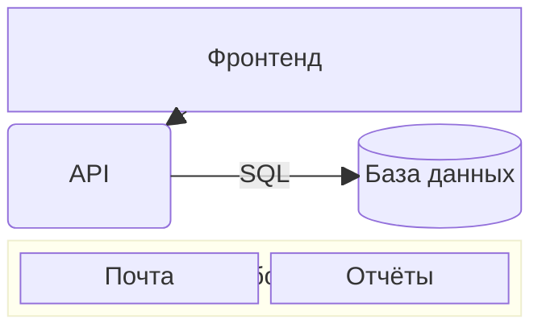

# Блочная диаграмма

Блоки, расставленные вручную по сетке, — в отличие от блок-схемы, которая
раскладывается сама.

| Синтаксис | |
|---|---|
| `columns 3` | число колонок; без него всё в одну строку |
| `a b c` | блоки, заполняют строки слева направо |
| `id:2` | блок шириной в две колонки |
| `space`, `space:2` | пустые ячейки |
| `a["Текст"]`, `a("…")`, `a(("…"))`, `a[("…")]`, `a{"…"}`, `a{{"…"}}`, `a>"…"]`, `a[/"…"/]` … | формы [блок-схемы](flowchart.md) |
| `block:id["Название"]:3` … `end` | вложенная сетка со своими `columns` |
| `a --> b`, `a --- b`, `a -.-> b`, `a ==> b`, `a -- "текст" --> b` | связи, прямые между блоками или группами |
| `style a fill:…`, `classDef`, `class a имя`, `a:::имя` | стили |
