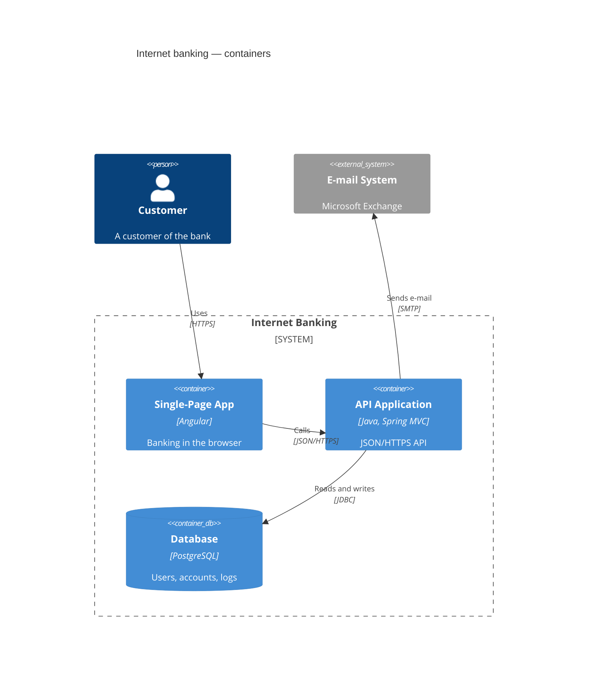

# Диаграммы C4



[Модель C4](https://c4model.com) в синтаксисе Mermaid, который повторяет
синтаксис C4-PlantUML: каждая инструкция — вызов макроса. Диаграммы
рисуются в классическом виде C4: персоны, синие блоки, светлеющие от систем
к компонентам, серые внешние элементы, пунктирные границы.

## Заголовок

Одно из `C4Context`, `C4Container`, `C4Component`, `C4Dynamic`,
`C4Deployment`. Синтаксис у них общий; ключевое слово меняет только то, что
нумеруется (см. [C4Dynamic](#c4dynamic)). `title …` отдельной строкой ставит
заголовок над диаграммой и служит её доступным именем; `accTitle:` и
`accDescr:` работают как везде. Комментарии начинаются с `%%`.

## Аргументы

Аргументы позиционные или именованные, их можно смешивать:

```
Container(api, "API", "Go", "Serves the shop")
Container(api, "API", $techn="Go", $descr="Serves the shop")
```

Значения пишутся в кавычках (`"…"`, нужны для запятых и скобок) или без
них. `<br>` и `\n` из C4-PlantUML переносят строку; длинный текст
переносится сам. `$sprite`, `$tags`, `$link` и `$baseShape` принимаются и
игнорируются — иконки, теги и ссылки не рисуются. Именованный аргумент,
которого у макроса нет, — ошибка: опечатку видно сразу, а не по пропавшему
значению.

## Элементы

| Макрос | Параметры |
|---|---|
| `Person`, `Person_Ext` | alias, label, ?descr, ?sprite, ?tags, ?link |
| `System`, `SystemDb`, `SystemQueue` (+ `_Ext`) | alias, label, ?descr, ?sprite, ?tags, ?link |
| `Container`, `ContainerDb`, `ContainerQueue` (+ `_Ext`) | alias, label, ?techn, ?descr, ?sprite, ?tags, ?link |
| `Component`, `ComponentDb`, `ComponentQueue` (+ `_Ext`) | alias, label, ?techn, ?descr, ?sprite, ?tags, ?link |

Каждый элемент показывает название жирным, строку типа — `[Person]`,
`[Software System]`, `[Container: технология]`, `[Component: технология]`,
с `External` впереди для `_Ext` — и описание. `$type="…"` у персоны или
системы заменяет строку типа. Элементы `…Db` — цилиндры, `…Queue` —
лежащие на боку трубы. Псевдонимы (alias) должны быть уникальны.

## Границы

```
Enterprise_Boundary(corp, "Big Bank plc") {
    System_Boundary(bank, "Internet Banking") {
        Container(api, "API", "Java")
    }
    Boundary(team, "Payments team", "squad") {
        Component(pay, "Payments", "Spring Bean")
    }
}
```

| Макрос | Параметры | Строка типа |
|---|---|---|
| `Boundary` | alias, label, ?type, ?tags, ?link | `[type]`, если задан |
| `Enterprise_Boundary` | alias, label, ?tags, ?link | `[Enterprise]` |
| `System_Boundary` | alias, label, ?tags, ?link | `[Software System]` |
| `Container_Boundary` | alias, label, ?tags, ?link | `[Container]` |

Границы вкладываются на любую глубину. Тело — `{ … }`; открывающая скобка
может стоять на следующей строке, `{}` — пустая граница. Граница рисуется
пунктирной рамкой с названием и типом в левом верхнем углу. Связь может
указывать на границу — тогда она заканчивается на её рамке.

## Узлы развёртывания

```
Deployment_Node(dc, "Big Bank plc", "Data centre") {
    Node(api, "bigbank-api x8", "Ubuntu 22.04") {
        Container(app, "API Application", "Java and Spring MVC")
    }
}
```

`Deployment_Node`, `Node`, `Node_L`, `Node_R` (и `Deployment_Node_L`,
`Deployment_Node_R`): alias, label, ?type, ?descr, ?sprite, ?tags, ?link.
Вкладываются как границы и рисуются сплошными рамками, каждый уровень чуть
темнее предыдущего. `_L` и `_R` в PlantUML — подсказки выравнивания, здесь
они рисуются как `Node`.

## Связи

| Макрос | Стрелка | Подсказка раскладке |
|---|---|---|
| `Rel(from, to, label, ?techn, ?descr)` | у `to` | — |
| `BiRel(…)` | с обеих сторон | — |
| `Rel_Back(from, to, …)` | у `from` | — |
| `Rel_D` / `Rel_Down` | у `to` | `to` ниже `from` |
| `Rel_U` / `Rel_Up` | у `to` | `to` выше `from` |
| `Rel_R` / `Rel_Right` | у `to` | `to` правее `from` |
| `Rel_L` / `Rel_Left` | у `to` | `to` левее `from` |
| `BiRel_U`, `BiRel_D`, `BiRel_L`, `BiRel_R` (и длинные формы) | с обеих сторон | как выше |
| `RelIndex(index, from, to, label, …)` | у `to` | — |
| `Lay_U`, `Lay_D`, `Lay_L`, `Lay_R` (и длинные формы) | не рисуется | как выше |

Связи — пунктирные линии с подписью на линии и технологией в квадратных
скобках под ней, `$descr` — курсивом ниже. Связь может идти раньше
элементов, которые она соединяет. Связь между элементом и границей, в
которой он лежит, — ошибка.

**Подсказки раскладке.** Диаграмма раскладывается слоями, как в
C4-PlantUML (Graphviz): связи идут сверху вниз, и каждый элемент ставится
как можно ближе к тому, с чем он связан. `Rel_U` разворачивает связь против
потока. `Rel_L` и `Rel_R` ставят два элемента рядом в один ряд, и связь
рисуется между ними прямой; если общий ряд невозможен (элементы в разных
границах или ряд пришлось бы разорвать), связь рисуется прямой, когда на её
пути ничего нет, а иначе раскладывается как обычная. `Lay_*` даёт те же
подсказки, ничего не рисуя.

`LAYOUT_LEFT_RIGHT()` (или `LAYOUT_LANDSCAPE()`) пускает связи слева
направо; подсказки сохраняют смысл на странице — `Rel_D` по-прежнему ставит
цель ниже. `LAYOUT_TOP_DOWN()` — по умолчанию.

## C4Dynamic

В диаграмме `C4Dynamic` все связи нумеруются в порядке записи, номер
показан в кружке перед подписью. `RelIndex` задаёт номер сам —
`RelIndex(5, a, b, "…")` покажет 5, а дальше пойдёт 6; нечисловой индекс
вроде `"2a"` показывается как написан. `Index()` берёт следующий номер,
`LastIndex()` повторяет последний. В остальных диаграммах C4 номер
показывает только `RelIndex`.

## Стили и раскладка

```
UpdateElementStyle(customer, $bgColor="grey", $fontColor="white", $borderColor="black")
UpdateBoundaryStyle(bank, $borderColor="#b91c1c")
UpdateRelStyle(customer, spa, $textColor="blue", $lineColor="blue")
UpdateLayoutConfig($c4ShapeInRow="3", $c4BoundaryInRow="1")
```

- `UpdateElementStyle` / `UpdateBoundaryStyle`: `$bgColor`, `$fontColor`,
  `$borderColor`. Цвета проверяются (`#rgb`, `#rrggbb`, `rgb(…)`,
  `hsl(…)`, имена); всё остальное — ошибка. `$shadowing`, `$shape`,
  `$sprite`, `$techn`, `$legendText`, `$legendSprite`, `$borderStyle` и
  `$borderThickness` принимаются и игнорируются.
- `UpdateRelStyle(from, to, …)`: `$textColor` и `$lineColor` для всех
  связей из `from` в `to`. `$offsetX` и `$offsetY` принимаются и
  игнорируются: подписи получают своё место в раскладке, и смещения,
  подобранные под расстановку Mermaid, только увели бы их с линии.
- `UpdateLayoutConfig`: элементы и границы, которых не касается ни одна
  связь, переносятся рядами — по `$c4ShapeInRow` элементов (по умолчанию 4)
  и по `$c4BoundaryInRow` границ (по умолчанию 2) в ряд, в порядке записи,
  как в Mermaid. Связанные элементы расставляются по своим связям.

## Темы

Палитра — собственная палитра модели C4: `--dg-c4-person-*`,
`--dg-c4-system-*`, `--dg-c4-container-*`, `--dg-c4-component-*` и
`--dg-c4-external-*` (`-fill`, `-stroke`, `-text`), а также
`--dg-c4-boundary-*` и `--dg-c4-node-*` для рамок; см.
[темы](theming.md#переменные). Цвета элементов читаются и на светлой, и на
тёмной странице; границы, узлы развёртывания и подписи связей следуют
`--dg-text`, `--dg-text-muted`, `--dg-line` и `--dg-edge-label-fill`, так
что тёмная тема для остальных диаграмм покрывает и C4.

У элементов есть классы `dg-c4-element`, `dg-c4-<уровень>` (`person`,
`system`, `container`, `component`), `dg-c4-<форма>` (`box`, `person`,
`db`, `queue`) и `dg-c4-external`, а также `data-id` с псевдонимом.

## Не поддерживается

Это ошибки, а не молча пропущенные инструкции:

- Легенды: `SHOW_LEGEND()`, `LAYOUT_WITH_LEGEND()`, `SHOW_FLOATING_LEGEND()`.
- Теги и их стили: `AddElementTag`, `AddRelTag`, `AddBoundaryTag`,
  `UpdateElementTag` и подобные (аргументы `$tags` при этом игнорируются).
- Свойства: `SetPropertyHeader`, `AddProperty`, `WithoutPropertyHeader`.
- `Rel_Neighbor`, `Lay_Distance`, `LAYOUT_AS_SKETCH()`, `HIDE_STEREOTYPE()`
  и переключатели спрайта персоны.
- Строки препроцессора PlantUML (`!include`, `!define`).

Спрайты и ссылки игнорируются: аргументы `$sprite` и `$link` принимаются,
но ничего для них не рисуется.
