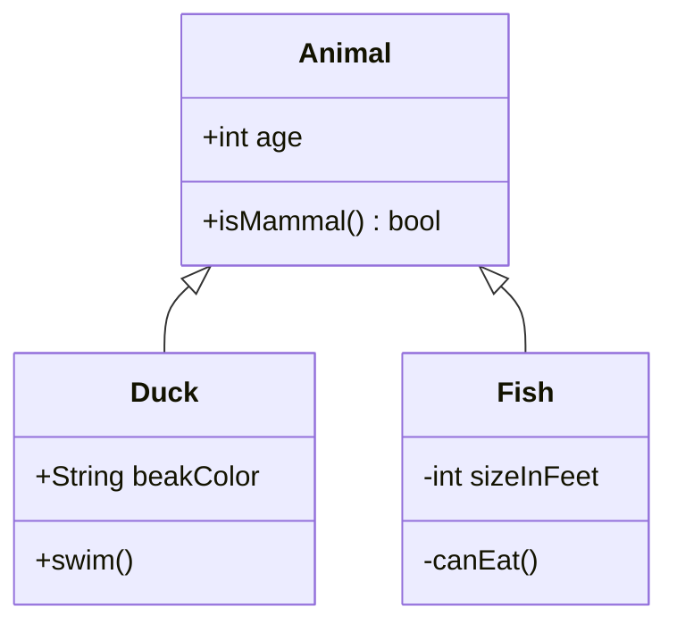

# Диаграмма классов



## Заголовок

`classDiagram` (или `classDiagram-v2`). `direction TB|BT|LR|RL` отдельной
строкой задаёт направление (по умолчанию сверху вниз).

## Классы

| Синтаксис | Значение |
|---|---|
| `class Animal` | класс |
| `class Square~T~` | обобщённый класс, показывается как `Square<T>` |
| `class Animal["Animal with a label"]` | класс с отображаемым именем |
| `class Shape <<interface>>` | класс с аннотацией |
| `class Animal:::name` | класс получает стилевой класс `name` |
| `class Duck {` … `}` | класс с телом из членов |

Id — буквы (любого алфавита), цифры и `_`, с `-` между ними. Класс создаётся
и первой связью, которая его упоминает.

## Члены класса

Внутри тела класса — по одному члену на строку; вне его — `Class : member`:

```
class BankAccount {
    +String owner
    +BigDecimal balance$
    +deposit(amount) bool
    +withdraw(amount)* int
}
BankAccount : -List~Transaction~ history
```

Член со скобками — метод, всё остальное — атрибут.

- **Видимость**: первый символ `+` (public), `-` (private), `#` (protected)
  или `~` (package) остаётся перед членом.
- **Тип результата**: текст после `)` — `+isMammal() bool` показывается как
  `+isMammal() : bool`.
- **Классификаторы**: `$` в конце (или сразу после `)`) — статический член,
  рисуется подчёркнутым; `*` — абстрактный, рисуется курсивом.
- **Обобщения**: `List~int~` показывается как `List<int>`, вложенные тоже:
  `Map~String, List~int~~` → `Map<String, List<int>>`.

Атрибуты попадают в первую секцию, методы — во вторую. Класс совсем без
членов рисуется одним именем.

## Аннотации

```
class Shape {
    <<interface>>
}
<<enumeration>> Color
class Service <<service>>
```

Любое слово между `<<` и `>>` — `interface`, `abstract`, `enumeration`,
`service` и так далее — показывается над именем класса как `«interface»`.

## Связи

`A <|-- B`, `A --> B : label`, `A "1" *-- "many" B : owns`.

| Синтаксис | Связь | Как рисуется |
|---|---|---|
| `<\|--` | наследование | полый треугольник |
| `*--` | композиция | закрашенный ромб |
| `o--` | агрегация | полый ромб |
| `<--` | ассоциация | открытая стрелка |
| `--` | связь | сплошная линия |
| `<\|..` | реализация | полый треугольник, пунктир |
| `<..` | зависимость | открытая стрелка, пунктир |
| `..` | пунктирная связь | пунктирная линия |

Наконечник может стоять на любом конце или на обоих: `B --|> A`, `A *--o B`,
`A <|--|> B`. Подпись идёт после `:`; кардинальность — строка в кавычках
рядом со своим классом: `Customer "1" --> "*" Ticket`. Класс может быть
связан сам с собой — такая связь рисуется петлёй сбоку от него.

Раскладка ставит первым «целый» конец связи — базовый класс при
наследовании, контейнер при композиции или агрегации, — так что иерархия
читается сверху вниз, в какую бы сторону ни были записаны стрелки.

## Пространства имён

```
namespace Shapes.Base {
    class Triangle
    class Rectangle {
        double width
    }
}
```

Пространство имён собирает объявления классов в рамку с заголовком. Как и в
Mermaid, внутрь можно писать только объявления `class` и аннотации; связи,
заметки и строки `Class : member` идут после блока. Пространства имён не
вкладываются друг в друга — иерархию показывает имя с точками (`A.B`).

## Заметки

```
note for Duck "can fly\nand swim"
note "a note on its own"
```

`\n` переносит строку. Заметка к классу соединяется с ним пунктиром; заметка
без `for` стоит отдельно.

## Стили и ссылки

- `classDef name fill:…,stroke:…`, `cssClass "A,B" name`, `class A:::name`
  и `style A …` работают так же, как в
  [блок-схемах](flowchart.md#стили-и-классы), с теми же проверяемыми
  свойствами. Заливка красит полосу заголовка; секции членов сохраняют свой
  фон.
- `link A "url" "tooltip"` и `click A href "url" "tooltip" _blank` делают
  класс ссылкой — с тем же фильтром схем, что и в блок-схемах.
- `callback A "fn"` и `click A call fn()` принимаются и игнорируются: скрипты
  из текста диаграммы никогда не выполняются.

## Комментарии

`%%` начинает комментарий — на отдельной строке или после инструкции.

## Не поддерживается

- Интерфейсы-«леденцы» (`()--`, `--()`).
- Имена классов в обратных кавычках (`` class `Animal Class!` ``) — используйте
  подпись: `class Animal["Animal Class!"]`.
- Параметры обобщения в инструкциях связи (`A~T~ <|-- B`) — объявите
  обобщение через `class A~T~` и ссылайтесь на класс как `A`.
- Вложенные пространства имён.
- Front matter (`---` … `---`) и `title`.
