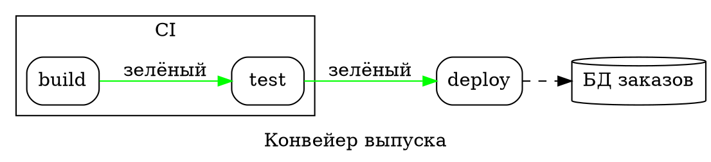

# Graphviz DOT

Исходник, который начинается с `digraph` или с `graph` и тела в фигурных
скобках, — это DOT (у Mermaid-овского `graph TD` скобок нет). Явно:
`render(source, { syntax: 'dot' })`. DOT рисуется раскладкой блок-схемы, а
не Graphviz, поэтому тот же граф выглядит здесь как блок-схема.

| Синтаксис | |
|---|---|
| `graph` / `digraph`, `strict` | ненаправленный (`--`) или направленный (`->`) |
| `a`, `a [label="…", shape=box]` | узел и его атрибуты |
| `a -> b -> c [label="…"]`, `a -> {b c}` | цепочки рёбер, к нескольким узлам сразу |
| `node [ … ]`, `edge [ … ]`, `graph [ … ]` | значения по умолчанию для того, что дальше, в своём подграфе |
| `rankdir=LR`, `label="…"` | направление (`TB`, `LR`, `BT`, `RL`) и заголовок |
| `subgraph cluster_x { label="…"; … }` | кластер в рамке; подграф без `cluster` только группирует |
| `a:port` | порты принимаются |
| `;`, переводы строк, `//`, `/* */`, `#` | разделители и комментарии |

**Атрибуты.** Узлы: `label` (записи `{a|b}` превращаются в строки; у
HTML-меток `<…>` теги отбрасываются; `\n`, `\l`, `\r` переносят строку),
`shape` (box, rect, ellipse, oval, circle, point, doublecircle, diamond,
hexagon, parallelogram, trapezium, invtrapezium, cylinder, note, folder,
tab, component, box3d, plaintext, record, Mrecord, …), `style` (rounded,
filled, dashed, dotted, invis), `color`, `fillcolor`, `fontcolor`. Рёбра:
`label`, `style` (dashed, dotted, bold, invis), `color`, `penwidth`, `dir`
(forward, back, both, none), `arrowhead` и `arrowtail` (normal, vee, empty,
diamond, odiamond, dot, none, tee, …), `minlen`. Кластеры: `label`,
`bgcolor`, `color`. Цвета — имена или `#rrggbb`, остальные пропускаются.
Атрибуты раскладки Graphviz (`pos`, `rank`, `constraint`, `splines`…)
принимаются и ничего не делают.
