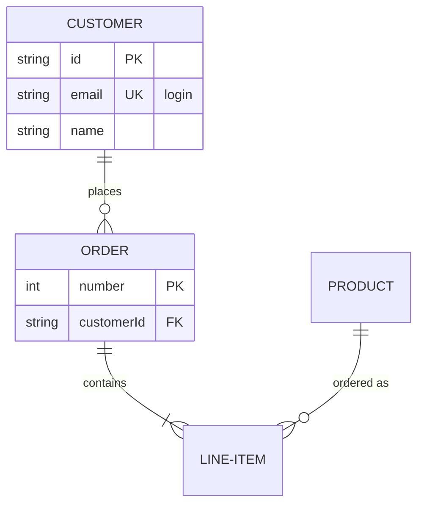

# ER-диаграмма



## Заголовок

`erDiagram`. `direction TB|BT|LR|RL` отдельной строкой задаёт направление
(по умолчанию сверху вниз).

## Сущности

| Синтаксис | Значение |
|---|---|
| `CUSTOMER` | сущность, названная по своему id |
| `LINE-ITEM` | id — буквы (любого алфавита), цифры и `_`, с `-` между ними |
| `"Order line"` | любое имя в двойных кавычках, в том числе с пробелами |
| `p["Person"]` или `p[Person]` | псевдоним: на блоке написано «Person», в связях используется `p` |
| `CUSTOMER:::name` | сущность получает класс `name` (см. [Стили](#стили)) |

Сущность создаётся первой же инструкцией, которая её упоминает; связи для
этого достаточно.

## Атрибуты

```
CUSTOMER {
    string id PK "the key"
    string email UK
    int orderNumber PK, FK
    decimal(10,2) total
    string[] tags
}
```

Один атрибут на строку внутри `{` … `}`: тип, имя, затем при необходимости
ключи и комментарий.

- **Тип**: начинается с буквы, `_` или `*`; может содержать `[]`, `()`, `,`
  и `-` — `decimal(10,2)`, `string[]`.
- **Имя**: слово; может начинаться с `*`.
- **Ключи**: `PK`, `FK`, `UK`, несколько — через запятую.
- **Комментарий**: текст в двойных кавычках.

Сущность рисуется таблицей: имя в полосе заголовка, затем по строке на
атрибут, тип, имя, ключи и комментарий — в выровненных колонках. Сущность
без атрибутов — просто её имя. `CUSTOMER {}` объявляет пустую сущность.

## Связи

```
CUSTOMER ||--o{ ORDER : places
CUSTOMER }|..|{ ADDRESS : "ships to"
```

Связь — это первая сущность, кардинальность, линия, кардинальность, вторая
сущность и, при необходимости, `:` с подписью (в кавычках или без).

| Слева | Справа | Кардинальность |
|---|---|---|
| `\|\|` | `\|\|` | ровно одна |
| `\|o` | `o\|` | ноль или одна |
| `}\|` | `\|{` | одна или больше |
| `}o` | `o{` | ноль или больше |

| Линия | Значение |
|---|---|
| `--` | идентифицирующая: сплошная линия |
| `..` (а также `.-`, `-.`) | неидентифицирующая: пунктирная линия |

Каждый конец рисуется в нотации «воронья лапка» там, где линия встречает
сущность. Сущность может быть связана сама с собой — такая связь рисуется
петлёй сбоку от неё.

**Словесная форма.** Работают и записанные словами кардинальности Mermaid,
с `to` (идентифицирующая) или `optionally to` (неидентифицирующая) вместо
линии:

```
CAR 1 to zero or more NAMED-DRIVER : allows
PERSON only one optionally to one or many ADDRESS : has
```

| Слова | Кардинальность |
|---|---|
| `only one`, `1` | ровно одна |
| `zero or one`, `one or zero` | ноль или одна |
| `one or more`, `one or many`, `many(1)`, `1+` | одна или больше |
| `zero or more`, `zero or many`, `many(0)`, `0+` | ноль или больше |

## Стили

`classDef name fill:…,stroke:…`, `class a,b name`, `ENTITY:::name` и
`style id …` работают так же, как в [блок-схемах](flowchart.md#стили-и-классы),
с теми же проверяемыми свойствами. У сущности с атрибутами заливка красит
полосу заголовка; строки сохраняют свой фон, чтобы их текст оставался
читаемым в тёмной теме.

## Комментарии

`%%` начинает комментарий — на отдельной строке или после инструкции.

## Не поддерживается

- Атрибуты на строке с открывающей `{` или несколько атрибутов на одной
  строке.
- Класс (`:::`) у сущности внутри инструкции связи — укажите его в
  объявлении.
- Front matter (`---` … `---`) и `title`.
