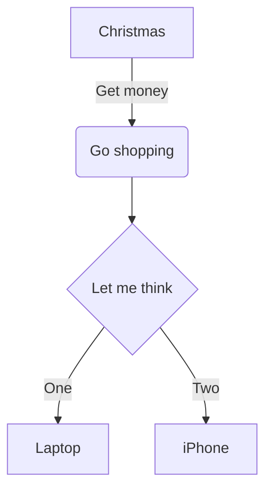
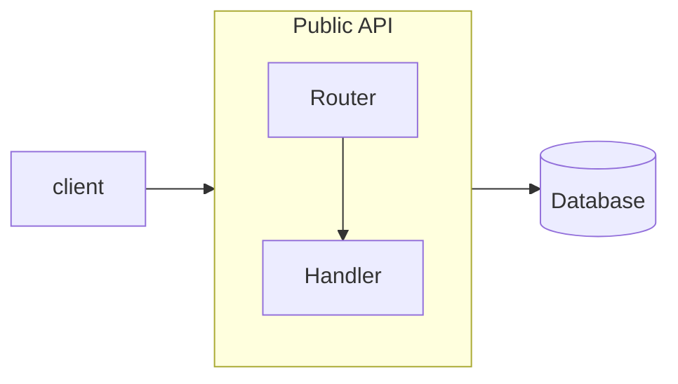

# Блок-схема



## Заголовок и направление

`flowchart` или `graph`, затем направление: `TB` (или `TD`, сверху вниз —
по умолчанию), `BT`, `LR`, `RL`.

## Узлы

Узел — это id, за которым может следовать его текст в фигуре:

| Синтаксис | Фигура |
|---|---|
| `id` | прямоугольник с id в качестве текста |
| `id[text]` | прямоугольник |
| `id(text)` | прямоугольник со скруглёнными углами |
| `id([text])` | «стадион» |
| `id[[text]]` | подпрограмма |
| `id[(text)]` | цилиндр (база данных) |
| `id((text))` | круг |
| `id(((text)))` | двойной круг |
| `id>text]` | асимметричная фигура |
| `id{text}` | ромб (решение) |
| `id{{text}}` | шестиугольник |
| `id[/text/]` | параллелограмм |
| `id[\text\]` | параллелограмм с обратным наклоном |
| `id[/text\]` | трапеция |
| `id[\text/]` | перевёрнутая трапеция |

Id состоят из букв (любой письменности), цифр, `_`, `.`, `$` и `-` между
буквами.

**Текст.** Заключите текст в двойные кавычки, чтобы использовать в нём скобки
и другие специальные символы: `A["a (b) [c]"]`. `<br>` переносит строку — это
единственный распознаваемый HTML; любая другая разметка выводится как текст.
Коды сущностей Mermaid работают: `#quot;`, `#35;`, `#x23;`.

**Строки Markdown.** Текст в обратных кавычках внутри кавычек,
``A["`**bold** and *italic*`"]``, поддерживает `**bold**` и `*italic*` /
`_italic_`, настоящие переводы строк и переносится по ширине 200 пикселей.

## Рёбра

| Синтаксис | Ребро |
|---|---|
| `A --> B` | стрелка |
| `A --- B` | линия без наконечника |
| `A -.-> B` / `A -.- B` | пунктир |
| `A ==> B` / `A === B` | толстая линия |
| `A --o B` | наконечник-кружок |
| `A --x B` | наконечник-крестик |
| `A <--> B`, `A o--o B`, `A x--x B` | наконечники на обоих концах |
| `A ~~~ B` | невидимое: влияет на раскладку, не рисуется |

**Длина.** Дополнительные штрихи растягивают ребро на большее число уровней:
`-->` — на один, `--->` — на два, `---->` — на три; так же для `-..->` и
`===>`.

**Текст на рёбрах.** `A -->|text| B`, `A -- text --> B`, `A -. text .-> B`,
`A == text ==> B`. Кавычки и строки Markdown работают так же, как для узлов.

**Цепочки и группы.** `A --> B --> C` — два ребра. `A & B --> C & D` —
четыре.

## Подграфы



- `subgraph id`, `subgraph id [title]`, `subgraph "title"` или
  `subgraph title with spaces` (тогда id — это заголовок с `_` вместо
  пробелов); закрывается `end`. Подграфы могут быть вложенными.
- Узел принадлежит первому подграфу, в котором он упомянут. Повторное
  упоминание на верхнем уровне не выводит его оттуда.
- Рёбра могут указывать на подграф по его id; они заканчиваются на его рамке.
- `direction` внутри подграфа задаёт его собственное направление. Как и в
  Mermaid, оно учитывается, если ни один узел внутри подграфа не связан с
  узлом снаружи (рёбра к самому подграфу допустимы). Такой подграф
  раскладывается отдельно и размещается единым блоком; подграф, рамку которого
  пересекают рёбра, раскладывается вместе с остальной диаграммой.

## Стили и классы

```
classDef warn fill:#fde68a,stroke:#b45309,color:#78350f
classDef default stroke-width:2px
A:::warn --> B
class B,C warn
style D fill:#bbf7d0,stroke:#15803d
linkStyle 0 stroke:#dc2626,stroke-width:2px
linkStyle default stroke-dasharray:4 2
```

`classDef default` применяется ко всем узлам. `linkStyle` нумерует рёбра с 0
в порядке их записи.

Принимаются только эти свойства, со значениями, проходящими проверку, — стиль
никогда не может загрузить URL или выйти за пределы диаграммы:

| Свойство | Значения |
|---|---|
| `fill`, `stroke`, `color` | `#rgb`, `#rgba`, `#rrggbb`, `#rrggbbaa`, `rgb()`, `rgba()`, `hsl()`, `hsla()`, названия цветов |
| `stroke-width`, `font-size` | число, при необходимости с `px` или `em` |
| `stroke-dasharray` | числа |
| `opacity`, `fill-opacity`, `stroke-opacity` | от 0 до 1 |
| `font-weight` | `normal`, `bold`, `100`–`900` |
| `font-style` | `normal`, `italic` |

Всё остальное — `DiagramError` с названием свойства.

## Ссылки

```
click A href "https://example.com" "Tooltip" _blank
click B "/docs/page"
```

Узел становится ссылкой. Разрешены `http:`, `https:`, `mailto:`,
относительные адреса и якоря; всё остальное (`javascript:`, `data:`, …) —
ошибка. `_blank` добавляет `rel="noopener noreferrer"`. `click id callback` —
вызов функции JavaScript — игнорируется: ничто из текста диаграммы никогда
не выполняется.

## Комментарии

`%%` начинает комментарий до конца строки. Директивы `%%{init: …}%%`
пропускаются.

## Не поддерживается

- Синтаксис узлов `A@{ shape: …, label: … }` (Mermaid 11) — ошибка;
  используйте фигуры со скобками.
- Id рёбер (`A e1@--> B`) и анимация рёбер.
- Значки Font Awesome (`fa:fa-car` выводится как текст).
- Обработчики `click` (игнорируются, см. выше).
- HTML в подписях, кроме `<br>` (выводится как текст).
